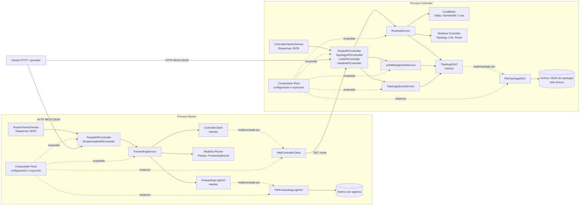
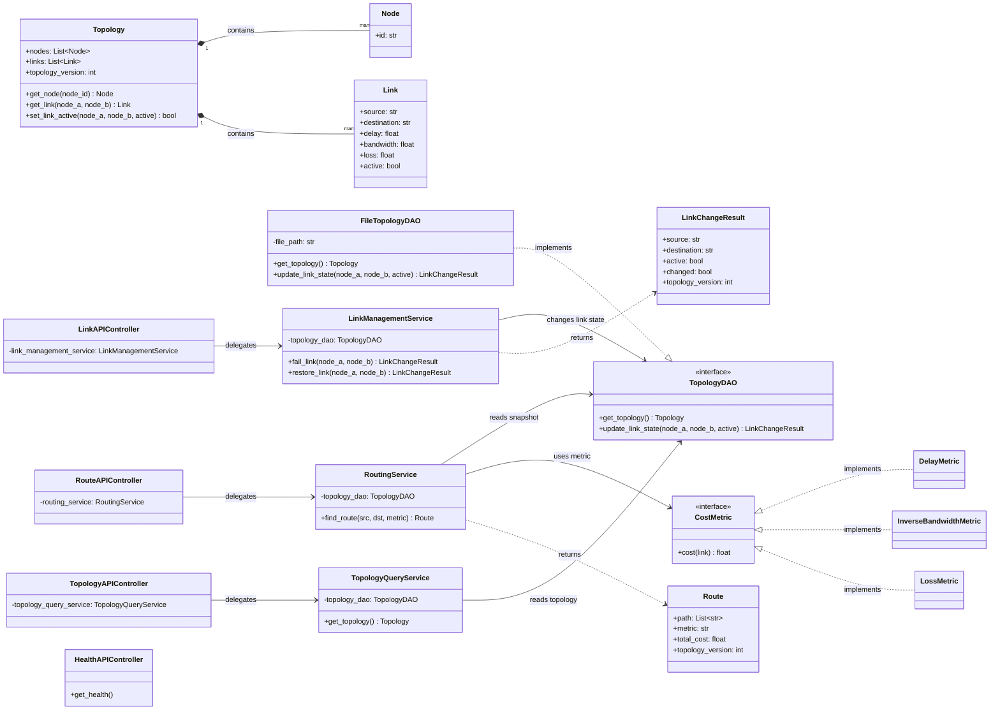
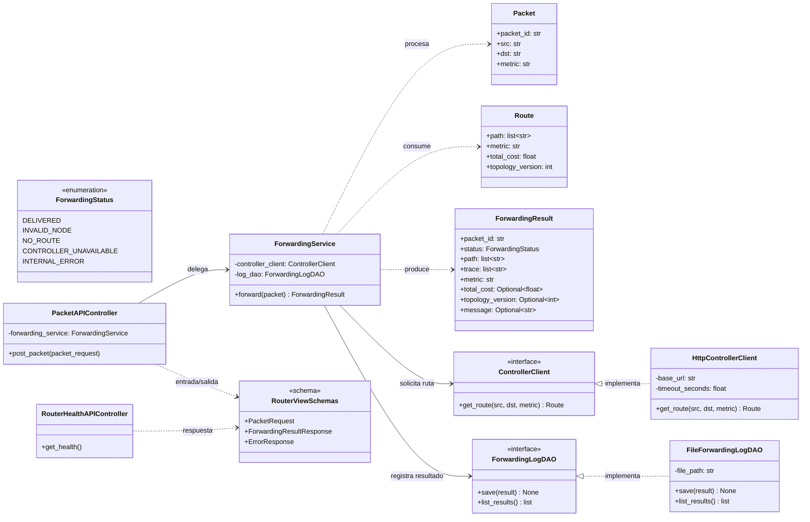

# 02 — Arquitectura estática

## Sistema educativo tipo SDN: Controller y Router

Proyecto: Aplicaciones Controller y Router comunicadas por REST/JSON  
Versión: 1.2 — línea base aprobada  
Fecha: 27 de octubre de 2026  
Sesión: 1 — Especificaciones y arquitectura  
Responsables: Andrés Felipe Mateus (Controller) y Santiago Ramirez Chavarro (Router)  
Documento de referencia: 01-requirements.md  
Estado: línea base aprobada

---

## 1\. Propósito y alcance

Este documento define los componentes, clases, interfaces y dependencias estáticas de las dos aplicaciones del sistema. Su objetivo es que la implementación siga una arquitectura modular, verificable y coherente con 01-requirements.md.

El sistema contiene dos procesos Python independientes:

- Controller: carga y mantiene la topología activa, calcula rutas de costo mínimo mediante Dijkstra y administra la falla y restauración de enlaces.  
- Router: recibe paquetes simulados, consulta la ruta al Controller mediante HTTP, simula el reenvío salto a salto y registra los resultados.

La comunicación entre procesos se realiza mediante REST/JSON. Es una simulación a nivel de aplicación: no implementa OpenFlow ni reenvía tráfico de red real. Las aplicaciones no comparten estado en memoria ni módulos de código de dominio.

Los nombres de clases y componentes definidos aquí constituyen la referencia aprobada. Si durante el desarrollo se aprueba un cambio de nombre o responsabilidad, se debe actualizar de forma coordinada el contrato API, los diagramas dinámicos, el plan de implementación y la especificación de pruebas.

### 1.1 Convenciones

- Controller y Router identifican las aplicaciones/procesos, no clases individuales.  
- Vista se refiere a los esquemas de validación, serialización y deserialización de la API.  
- Controlador HTTP se refiere al componente MVC que atiende una operación REST.  
- DAO abstrae el acceso a almacenamiento persistente o a la fuente de topología.  
- Los errores de dominio se distinguen de los errores HTTP y de transporte.

### 1.2 Alcance de los diagramas

Los diagramas estáticos describen los componentes y clases del dominio que participan en la arquitectura. Los actores externos —por ejemplo, un cliente HTTP— pueden aparecer en diagramas sin definirse como clases internas de las aplicaciones.

---

## 2\. Decisiones arquitectónicas

| ID | Decisión | Justificación y restricción |
| :---- | :---- | :---- |
| AD-01 | Controller y Router son procesos Python independientes que se comunican mediante REST/JSON. | No comparten estado de ejecución ni código de dominio. Cada aplicación mantiene sus propias vistas y su propio ErrorResponse. |
| AD-02 | Ambas aplicaciones siguen una arquitectura MVC por capas, complementada con servicios de dominio. | Los controladores HTTP coordinan solicitudes; los servicios contienen la lógica de aplicación/dominio; los modelos representan conceptos del sistema. |
| AD-03 | El acceso a datos y servicios externos se abstrae mediante interfaces. | Las implementaciones productivas y los sustitutos de prueba pueden intercambiarse mediante inyección de dependencias. |
| AD-04 | FileTopologyDAO carga y valida el archivo JSON de topología al iniciar el Controller y mantiene el estado activo en memoria. | El archivo original es de solo lectura durante la ejecución. Las fallas y restauraciones no se escriben en el JSON. El DAO coordina el acceso concurrente a las modificaciones; Topology.set\_link\_active() es responsable de cambiar el estado del enlace y aumentar topology\_version únicamente ante un cambio efectivo. |
| AD-05 | El cálculo de costos utiliza el patrón Strategy mediante CostMetric. | Se implementan DelayMetric, InverseBandwidthMetric y LossMetric; se pueden probar de forma independiente. |
| AD-06 | El Router obtiene rutas exclusivamente mediante la interfaz ControllerClient. | HttpControllerClient implementa la comunicación HTTP. ForwardingService no calcula caminos ni mantiene una topología autoritativa local. |
| AD-07 | Las dependencias se inyectan por constructor y se ensamblan en el punto de composición de cada aplicación. | Solo el punto de composición instancia las implementaciones concretas de producción y las conecta con servicios y controladores. |
| AD-08 | Los errores de dominio se convierten en respuestas HTTP mediante ApiErrorMapper. | La validación de solicitudes inválidas se representa como 400 INVALID\_INPUT; los errores no deben filtrarse como trazas o detalles internos. La validación de esquemas no debe devolver 422\. |
| AD-09 | ForwardingService.forward() produce un ForwardingResult para los resultados de reenvío esperados, incluidos errores de nodo, ausencia de ruta y falta de disponibilidad del Controller. | El resultado se registra mediante ForwardingLogDAO. Si el almacenamiento falla, no se debe afirmar que el resultado quedó persistido: el endpoint devuelve 500 INTERNAL\_ERROR. |
| AD-10 | El Router valida localmente los campos de la solicitud y la métrica antes de contactar al Controller. | Se preservan errores de aplicación válidos del Controller, incluidos 404 NODE\_NOT\_FOUND y 404 PATH\_NOT\_FOUND. Un 400 inesperado después de validar la entrada, una respuesta malformada o incompatible, un error de transporte, timeout o fallo del servidor se tratan como 503 CONTROLLER\_UNAVAILABLE. |
| AD-11 | NetworkX y el algoritmo Dijkstra se utilizan únicamente en el Controller. | El Router no importa NetworkX ni calcula rutas alternativas. |
| AD-12 | RoutingService construye el grafo de NetworkX para cada consulta a partir de una instantánea de topología. | Esta estrategia prioriza la sencillez y la coherencia. Solo se considerará una caché indexada por topology\_version si las mediciones de NFR-10 muestran que es necesaria. |

### 2.1 Métricas de costo

Para cada enlace utilizable se define el costo según la métrica solicitada:

- delay: costo del enlace igual a su retardo d.  
- bandwidth: costo del enlace igual a 1 / b, con b \> 0\. La suma de estos valores no equivale a maximizar el ancho de banda de cuello de botella.  
- loss: costo del enlace igual a \-ln(1 \- p), para 0 ≤ p \< 1\.

La topología se trata como no dirigida. Solo se consideran enlaces activos y utilizables; un enlace con p \= 1 no puede formar parte de una ruta, aunque su atributo active sea true. Los costos deben ser no negativos para aplicar Dijkstra.

### 2.2 Versionado de topología

topology\_version inicia en 1 por cada arranque del Controller. Aumenta una unidad únicamente cuando una operación cambia efectivamente el estado activo/inactivo de un enlace. Repetir una falla sobre un enlace ya inactivo o una restauración sobre uno ya activo no incrementa la versión. El estado dinámico no se persiste en el archivo JSON; al reiniciar, se recupera el estado definido en el archivo de entrada.

---

## 3\. Diagrama de componentes



&nbsp;

Lectura del diagrama: cada aplicación es un proceso independiente. El cliente puede consultar la API del Controller o enviar paquetes al Router. Para procesar un paquete válido, el Router solicita una ruta mediante GET /route. El Controller obtiene una instantánea de la topología a través de TopologyDAO; el Router registra resultados mediante ForwardingLogDAO.

Las flechas continuas representan dependencias de uso o llamadas. Las flechas discontinuas con la etiqueta «implementada por» representan implementación de interfaces. Las dependencias discontinuas desde Composition Root representan ensamblaje o creación de dependencias en tiempo de ejecución. El diagrama omite algunos detalles de configuración y serialización para conservar legibilidad; se detallan en las secciones siguientes.

---

## 4\. Capas y responsabilidades MVC/DAO

### 4.1 Controller

| Elemento | Capa o patrón | Responsabilidad | No debe hacer |
| :---- | :---- | :---- | :---- |
| Topology, Link, Route, LinkChangeResult | Modelo | Representar topología, enlaces, rutas y resultados de cambios de estado. | Leer archivos, atender HTTP o depender de frameworks web. |
| CostMetric, DelayMetric, InverseBandwidthMetric, LossMetric | Estrategia de dominio | Calcular el costo de cada enlace según la métrica. | Leer topología desde archivos o atender HTTP. |
| ControllerViewSchemas | Vista | Validar y serializar parámetros, cuerpos JSON y respuestas del contrato REST. | Calcular rutas o mutar directamente el estado de dominio. |
| RouteAPIController | Controlador MVC | Atender GET /route, validar parámetros, delegar en RoutingService y traducir resultados/errores a HTTP. | Ejecutar Dijkstra o construir el grafo. |
| TopologyAPIController | Controlador MVC | Atender GET /topology, delegar en TopologyQueryService y devolver la topología activa y su versión. | Leer directamente el archivo JSON. |
| LinkAPIController | Controlador MVC | Atender POST /links/fail y POST /links/restore, delegando los cambios en LinkManagementService. | Manipular archivos o implementar lógica de cálculo de rutas. |
| HealthAPIController | Controlador MVC | Atender GET /health e informar la salud del propio Controller. | Ejecutar operaciones de enrutamiento. |
| RoutingService | Servicio de dominio | Validar nodos y métrica, obtener una instantánea, construir el grafo, calcular Dijkstra y producir Route. | Acceder directamente al sistema de archivos o instanciar un DAO concreto. |
| LinkManagementService | Servicio de dominio | Coordinar las operaciones de falla y restauración y traducir el resultado del cambio. | Leer o escribir el archivo JSON directamente. |
| TopologyQueryService | Servicio de aplicación | Obtener la instantánea actual mediante TopologyDAO para GET /topology. | Leer directamente el archivo JSON o modificar el estado de los enlaces. |
| TopologyDAO | Interfaz DAO | Definir operaciones para obtener una instantánea y actualizar el estado de un enlace. | Exponer detalles del almacenamiento. |
| FileTopologyDAO | Implementación DAO | Cargar y validar la topología inicial; proteger el estado en memoria y coordinar modificaciones concurrentes. | Calcular rutas o atender solicitudes HTTP. |
| Composition Root | Ensamblaje/configuración | Leer configuración, instanciar implementaciones concretas e inyectarlas. | Contener lógica de dominio o algoritmos de enrutamiento. |

Reglas de modelo: las clases de dominio pueden depender de otros módulos del dominio y de la biblioteca estándar de Python. No deben depender de frameworks web, DAO, clientes HTTP ni operaciones directas de archivo. El acceso al almacenamiento se mantiene en los adaptadores concretos.

Estado de topología: FileTopologyDAO carga la topología al iniciar y conserva el estado activo en memoria. Las operaciones de falla/restauración no modifican el archivo original. Topology.set\_link\_active() realiza el cambio de estado y aumenta topology\_version solo si el estado cambia efectivamente. El DAO serializa las actualizaciones concurrentes y entrega instantáneas consistentes e independientes del estado compartido.

### 4.2 Router

| Elemento | Capa o patrón | Responsabilidad | No debe hacer |
| :---- | :---- | :---- | :---- |
| Packet | Modelo | Representar la solicitud validada con packet\_id, src, dst y metric. | Consultar HTTP o persistir registros. |
| ForwardingResult | Modelo | Representar estado, ruta, traza, métrica, costo, versión de topología y mensaje asociado al resultado. | Ejecutar solicitudes HTTP o escribir archivos. |
| RouterViewSchemas | Vista | Validar y serializar solicitudes/respuestas JSON de la API del Router. | Simular saltos o consultar directamente al Controller. |
| PacketAPIController | Controlador MVC | Atender POST /packets, validar la entrada, delegar en ForwardingService y convertir el resultado a HTTP/JSON. | Calcular rutas o simular el reenvío directamente. |
| RouterHealthAPIController | Controlador MVC | Atender GET /health e informar la disponibilidad del propio Router. | Depender de que el Controller esté disponible. |
| ForwardingService | Servicio de dominio | Solicitar ruta al Controller, simular el recorrido, producir ForwardingResult y pedir su registro. | Calcular rutas localmente o acceder directamente al archivo de registros. |
| ControllerClient | Interfaz de integración | Definir la operación get\_route(src, dst, metric) y sus errores de dominio. | Implementar Dijkstra o mantener una topología autoritativa local. |
| HttpControllerClient | Adaptador HTTP | Consultar GET /route, aplicar timeout y validar la respuesta del Controller. | Recalcular rutas o modificar la topología. |
| ForwardingLogDAO | Interfaz DAO | Definir save(result) y, si se requiere internamente, recuperación de registros. | Depender de rutas concretas de archivo. |
| FileForwardingLogDAO | Implementación DAO | Persistir resultados en el archivo local configurable. Crear el archivo de registro si aún no existe, cuando se realiza la primera escritura. | Simular reenvíos o consultar al Controller. |
| Composition Root | Ensamblaje/configuración | Instanciar el cliente HTTP, DAO y servicios, y conectarlos con los controladores. | Contener la lógica de reenvío. |

El Router registra los resultados de paquetes que superan la validación de entrada, incluidos los resultados DELIVERED, INVALID\_NODE, NO\_ROUTE, CONTROLLER\_UNAVAILABLE e INTERNAL\_ERROR. Una solicitud mal formada que produzca 400 INVALID\_INPUT no se registra. Si falla la persistencia del resultado, el endpoint devuelve 500 INTERNAL\_ERROR; no debe afirmar que el resultado quedó almacenado. El Router permanece activo tras el error.

### 4.3 Reglas de dependencia entre capas

1. Los controladores HTTP dependen de servicios y esquemas de vista.  
2. Los servicios dependen de abstracciones (TopologyDAO, ControllerClient, ForwardingLogDAO), no de sus implementaciones concretas.  
3. Las implementaciones DAO/adaptadores encapsulan archivos y comunicación HTTP.  
4. Los modelos de dominio no dependen de controladores HTTP, vistas, frameworks, DAO ni adaptadores de transporte.  
5. El Composition Root es el único lugar de producción que instancia las implementaciones concretas y las conecta entre sí. Las pruebas pueden instanciar las implementaciones o fakes que necesiten.

---

## 5\. Interfaces y dependencias

### 5.1 Interfaces de acceso a datos e integración

#### TopologyDAO

Interfaz del Controller para acceder a la topología activa.

- get\_topology() \-\> Topology: devuelve una instantánea consistente e independiente de la topología compartida. Las modificaciones posteriores no deben cambiar una instantánea ya entregada.  
- update\_link\_state(node\_a, node\_b, active) \-\> LinkChangeResult: actualiza el estado del enlace no dirigido de forma sincronizada. La operación devuelve el estado resultante y la versión correspondiente. Si no hay cambio efectivo, la versión no aumenta.

Implementación de producción: FileTopologyDAO. Sustituto de pruebas: FakeTopologyDAO, que trabaja en memoria sin archivo ni servidor HTTP.

#### ForwardingLogDAO

Interfaz del Router para registrar resultados.

- save(result: ForwardingResult) \-\> None: persiste el resultado o lanza LogStorageError si la operación falla.  
- list\_results() \-\> list\[ForwardingResult\]: operación interna opcional para recuperar resultados cuando sea necesaria; no implica que exista un endpoint HTTP público para consultar registros.

Implementación de producción: FileForwardingLogDAO. Sustituto de pruebas: InMemoryForwardingLogDAO o FakeForwardingLogDAO.

Si falla save() o una operación interna list\_results(), la implementación debe lanzar LogStorageError sin finalizar el proceso. Cuando un endpoint depende de una escritura que falla, debe responder 500 INTERNAL\_ERROR y no declarar que el resultado quedó persistido.

#### ControllerClient

Interfaz del Router para solicitar una ruta.

- get\_route(src: str, dst: str, metric: str) \-\> Route: devuelve una ruta válida o lanza un error de dominio conocido.  
- HttpControllerClient implementa esta interfaz mediante REST/JSON.  
- FakeControllerClient permite probar el Router sin un servidor HTTP, devolviendo rutas o errores predefinidos.

HttpControllerClient utiliza un timeout configurable, cuyo valor predeterminado es de 2 segundos, y no realiza reintentos automáticos.

### 5.2 Inyección de dependencias

| Componente | Dependencias inyectadas | Implementación de producción | Sustituto para pruebas |
| :---- | :---- | :---- | :---- |
| RoutingService | TopologyDAO, Mapping\[str, CostMetric\] | FileTopologyDAO y estrategias de costo registradas por clave | FakeTopologyDAO y estrategias deterministas |
| LinkManagementService | TopologyDAO | FileTopologyDAO | FakeTopologyDAO |
| TopologyQueryService | TopologyDAO | FileTopologyDAO | FakeTopologyDAO |
| ForwardingService | ControllerClient, ForwardingLogDAO, reloj opcional | HttpControllerClient, FileForwardingLogDAO | FakeControllerClient, InMemoryForwardingLogDAO y reloj falso |
| RouteAPIController | RoutingService | Servicio construido por el punto de composición | Servicio real con DAO falso o doble de prueba |
| TopologyAPIController | TopologyQueryService | Servicio construido por el punto de composición | Servicio con DAO falso |
| LinkAPIController | LinkManagementService | Servicio construido por el punto de composición | Servicio con DAO falso |
| PacketAPIController | ForwardingService | Servicio construido por el punto de composición | Servicio con cliente y DAO falsos |
| HttpControllerClient | URL base del Controller, timeout y cliente de transporte | Configuración de entorno/archivo de configuración | Transporte simulado cuando sea necesario |

Mapping\[str, CostMetric\] es un mapeo cuyas claves son exactamente delay, bandwidth y loss. RoutingService no crea internamente FileTopologyDAO; ForwardingService no crea internamente FileForwardingLogDAO ni HttpControllerClient. Esta separación permite pruebas unitarias sin archivos ni servidores HTTP y apoya los requisitos de modularidad y testabilidad.

### 5.3 Punto de composición y configuración

Cada proceso tiene su propio punto de composición (por ejemplo, controller/app.py y router/app.py o módulos equivalentes). Este punto:

1. Lee puertos, rutas de archivos, URL del Controller y timeout desde configuración externa.  
2. Instancia las implementaciones concretas de DAO y adaptadores.  
3. Crea las estrategias de costo y los servicios.  
4. Inyecta las dependencias en los controladores HTTP.  
5. Registra rutas HTTP y el mapeador de errores.

Si el Controller no puede cargar o validar la topología inicial, debe abortar el arranque con código de salida no cero y un mensaje operativo claro. No debe iniciar con una topología parcialmente cargada. La configuración del Router no debe exigir que el Controller esté disponible para iniciar ni para responder GET /health.

---

## 6\. Diagramas de clases

Los diagramas identifican las clases de dominio, servicios, controladores HTTP, esquemas de API, adaptadores y DAOs previstos. Los errores de dominio se muestran de manera resumida para no saturar los diagramas; su catálogo y mapeo se especifican en la sección 7\.

### 6.1 Clases principales del Controller



&nbsp;

### 6.2 Clases principales del Router



&nbsp;

ForwardingResult.total\_cost, ForwardingResult.topology\_version y ForwardingResult.message son opcionales porque algunos resultados fallidos pueden producirse antes de recibir una ruta válida del Controller. Los esquemas de respuesta de la API deben conservar esa opcionalidad. El modelo Route representa una respuesta de ruta válida y, por tanto, sus costo y versión no son opcionales.

### 6.3 Convenciones de los diagramas

- \+ indica miembro público y \- miembro privado.  
- \<\<interface\>\> identifica una abstracción intercambiable.  
- \<\<schema\>\> identifica esquemas de validación/serialización de API.  
- Optional\[T\] indica que el valor puede ser None y debe serializarse como null o excluirse según el contrato acordado; esta decisión se fijará en 04-api-contract.md.  
- Mapping\[str, CostMetric\] asocia las claves delay, bandwidth y loss con su estrategia.  
- Los errores de dominio se omiten de los diagramas principales por legibilidad, pero se definen en la sección 7\.

---

## 7\. Catálogo de clases, errores y comportamiento

### 7.1 Controller

#### Topology, Link, Route y LinkChangeResult

- Link representa un enlace no dirigido con nodos extremos, retardo, ancho de banda, probabilidad de pérdida y estado activo.  
- Topology mantiene nodos, enlaces y topology\_version. Su método set\_link\_active() modifica el estado del enlace y devuelve si hubo cambio efectivo. La versión aumenta solo en caso de cambio efectivo.  
- Route contiene el camino ordenado, la métrica, el costo total y la versión de topología utilizada para el cálculo.  
- LinkChangeResult informa el estado final del enlace, si hubo cambio y la versión resultante.

FileTopologyDAO valida la estructura del JSON de entrada, las referencias de nodos, la ausencia de enlaces duplicados no permitidos y los dominios de valores de métricas definidos en 01-requirements.md. Protege la lectura/modificación del estado compartido mediante un bloqueo. Para actualizar un enlace, obtiene el enlace bajo el bloqueo, llama a Topology.set\_link\_active() y devuelve el resultado consistente. El archivo de topología nunca se modifica.

Un enlace con p \= 1 puede cambiar entre activo e inactivo como estado administrativo, pero sigue siendo inutilizable para el cálculo de rutas. El cambio de su estado administrativo sí incrementa la versión cuando el estado cambia efectivamente.

#### RoutingService y estrategias de costo

RoutingService obtiene una instantánea mediante TopologyDAO.get\_topology() y construye el grafo de NetworkX exclusivamente a partir de esa instantánea. La consulta no modifica el estado compartido. La ruta y topology\_version devueltas corresponden a la misma instantánea.

Errores de dominio del Controller:

| Excepción | Situación | HTTP / código |
| :---- | :---- | :---- |
| InvalidInputError | Parámetro o métrica inválida. | 400 INVALID\_INPUT |
| NodeNotFoundError | El origen o destino no pertenece a la topología. | 404 NODE\_NOT\_FOUND |
| LinkNotFoundError | El enlace solicitado para falla/restauración no existe. | 404 LINK\_NOT\_FOUND |
| PathNotFoundError | Los nodos existen, pero no hay camino utilizable. | 404 PATH\_NOT\_FOUND |
| TopologyLoadError | No se puede leer o validar la topología al iniciar. | El arranque aborta con código no cero; no se expone como endpoint operativo. |
| Error inesperado | Fallo interno no previsto. | 500 INTERNAL\_ERROR |

#### TopologyQueryService

Obtiene la instantánea actual mediante TopologyDAO.get\_topology() para atender GET /topology. No modifica la topología ni accede directamente al archivo fuente.

#### LinkManagementService

Coordina falla y restauración a través de TopologyDAO.update\_link\_state(). No mantiene una segunda copia autoritativa de la topología y no modifica el archivo fuente. Las operaciones deben ser idempotentes respecto del estado: repetir la misma operación no produce una versión nueva si no cambia el estado del enlace.

### 7.2 Router

#### ForwardingService

ForwardingService.forward(packet) solicita una ruta a ControllerClient, simula el recorrido y construye un ForwardingResult. No ejecuta Dijkstra ni reintenta con una ruta local. Los errores esperados se convierten en resultados de dominio y se intenta registrar el resultado. Si la persistencia falla, el servicio propaga LogStorageError para que el límite HTTP responda 500 INTERNAL\_ERROR; no debe sustituir ese error por una respuesta de reenvío aparentemente persistida.

El Router utiliza un timeout predeterminado de 2 segundos y no realiza reintentos automáticos. El endpoint GET /health informa el estado del Router y no requiere que el Controller esté disponible.

#### HttpControllerClient

Clasificación de respuestas del Controller:

- Una respuesta exitosa con JSON válido y campos compatibles se convierte en Route.  
- Un 404 NODE\_NOT\_FOUND válido se conserva como error de aplicación y se traduce en resultado INVALID\_NODE y respuesta HTTP 404 NODE\_NOT\_FOUND del Router.  
- Un 404 PATH\_NOT\_FOUND válido se conserva como error de aplicación y se traduce en resultado NO\_ROUTE y respuesta HTTP 404 PATH\_NOT\_FOUND del Router.  
- Errores de conexión, DNS, timeout, respuesta no HTTP, JSON malformado, campos requeridos ausentes, tipos incompatibles, contrato incompatible y respuestas 5xx se convierten en ControllerUnavailableError y en 503 CONTROLLER\_UNAVAILABLE.  
- Un 400 del Controller después de que el Router haya validado la solicitud se considera inesperado/incompatible y se convierte en 503 CONTROLLER\_UNAVAILABLE. No se confunde con el 400 INVALID\_INPUT producido por la validación local del Router.  
- Los errores de aplicación válidos que el contrato autorice se preservan; los cuerpos de error desconocidos o incompatibles se tratan como fallo de comunicación.

Una respuesta HTTP exitosa que contenga JSON inválido o una estructura incompatible no se acepta como ruta válida. El Router permanece activo y responde 503 CONTROLLER\_UNAVAILABLE.

#### Errores de dominio del Router

| Excepción | Situación | HTTP / código |
| :---- | :---- | :---- |
| InvalidInputError | Solicitud inválida detectada localmente antes de llamar al Controller. | 400 INVALID\_INPUT; no se registra resultado de reenvío. |
| NodeNotFoundError | El Controller informa válidamente que origen/destino no existe. | 404 NODE\_NOT\_FOUND; resultado INVALID\_NODE sujeto a persistencia. |
| PathNotFoundError | El Controller informa válidamente que no hay ruta. | 404 PATH\_NOT\_FOUND; resultado NO\_ROUTE sujeto a persistencia. |
| ControllerUnavailableError | Timeout, error de transporte, respuesta inválida/incompatible o fallo del Controller. | 503 CONTROLLER\_UNAVAILABLE; resultado CONTROLLER\_UNAVAILABLE sujeto a persistencia. |
| LogStorageError | No se puede persistir o recuperar un registro. | 500 INTERNAL\_ERROR cuando la operación solicitada depende del almacenamiento. El proceso no debe terminar. |
| Error inesperado | Fallo interno no previsto. | 500 INTERNAL\_ERROR, sin detalles internos en la respuesta. |

Cuando la persistencia falla durante POST /packets, el Router devuelve 500 INTERNAL\_ERROR, incluso si el reenvío ya se simuló. La respuesta no debe afirmar que el resultado quedó registrado. La respuesta de error no incluye un packet\_id salvo que 04-api-contract.md lo establezca expresamente; para mantener una línea base sencilla, el contrato debe usar un único esquema de error compartido por los endpoints de cada aplicación.

### 7.3 ApiErrorMapper y respuestas HTTP

Cada aplicación tiene su propio ApiErrorMapper, que transforma errores de validación, dominio y ejecución en su esquema ErrorResponse. Los códigos y estados HTTP acordados son:

| HTTP | Código | Uso |
| ----: | :---- | :---- |
| 400 | INVALID\_INPUT | Solicitud inválida, parámetro ausente o métrica no admitida. |
| 404 | NODE\_NOT\_FOUND | El origen o destino no existe. |
| 404 | LINK\_NOT\_FOUND | El enlace solicitado no existe. |
| 404 | PATH\_NOT\_FOUND | Los nodos existen, pero no existe camino utilizable. |
| 503 | CONTROLLER\_UNAVAILABLE | El Router no obtiene una respuesta válida del Controller. |
| 500 | INTERNAL\_ERROR | Fallo interno, incluida la persistencia fallida del registro. |

LINK\_NOT\_FOUND se utiliza en las operaciones de falla/restauración del Controller. NODE\_NOT\_FOUND y PATH\_NOT\_FOUND pueden originarse en el Controller y preservarse en el Router solo cuando la respuesta recibida cumple el contrato esperado. El Router no convierte indiscriminadamente todos los errores HTTP del Controller en 503\.

Para `POST /packets`, una excepción interna inesperada durante el procesamiento de una solicitud que superó la validación local produce HTTP `500 INTERNAL_ERROR`. El Router intenta registrar un `ForwardingResult` con estado `INTERNAL_ERROR` si dispone de la información necesaria. Si el registro falla, la respuesta no debe afirmar que el resultado quedó persistido. La respuesta incluye el `packet_id` conforme a la regla de errores posteriores a la validación local. Las solicitudes inválidas que producen HTTP `400 INVALID_INPUT` no generan registros.

---

## 8\. Estructura de paquetes

La estructura siguiente es la estructura modular de referencia de la línea base; los nombres de archivos se mantienen conforme a los artefactos aprobados.

```
project/
├── controller/
│   ├── app.py                    # Composition Root y servidor HTTP
│   ├── config.py                 # Configuración externa
│   ├── views/
│   │   └── schemas.py            # Esquemas JSON de la API
│   ├── controllers/
│   │   ├── route_controller.py
│   │   ├── topology_controller.py
│   │   ├── link_controller.py
│   │   └── health_controller.py
│   ├── services/
│   │   ├── routing_service.py
│   │   └── topology_service.py
│   ├── domain/
│   │   ├── models.py             # Topology, Link, Route, LinkChangeResult
│   │   ├── metrics.py            # CostMetric y estrategias
│   │   └── errors.py             # Errores de dominio
│   ├── dao/
│   │   ├── interfaces.py         # TopologyDAO
│   │   └── file_topology_dao.py
│   └── api_error_mapper.py
├── router/
│   ├── app.py                    # Composition Root y servidor HTTP
│   ├── config.py
│   ├── views/
│   │   └── schemas.py
│   ├── controllers/
│   │   ├── packet_controller.py
│   │   └── health_controller.py
│   ├── services/
│   │   └── forwarding_service.py
│   ├── domain/
│   │   ├── models.py             # Packet, Route y ForwardingResult
│   │   └── errors.py
│   ├── clients/
│   │   ├── interfaces.py         # ControllerClient
│   │   └── http_controller_client.py
│   ├── dao/
│   │   ├── interfaces.py         # ForwardingLogDAO
│   │   └── file_forwarding_log_dao.py
│   └── api_error_mapper.py
├── data/
│   └── topology.json             # Entrada de topología; solo lectura
├── logs/
│   └── forwarding.jsonl          # Registro creado al primer guardado
└── tests/
    ├── unit/
    ├── integration/
    └── architecture/
```

Las carpetas data/ y logs/ representan valores predeterminados ilustrativos; las rutas reales deben poder configurarse. El registro de reenvío puede crearse en la primera escritura. Esto no autoriza ni implica modificar topology.json.

---

## 9\. Interacciones estáticas y secuencias de referencia

Esta sección resume las dependencias que los diagramas dinámicos posteriores deberán detallar. No sustituye el entregable 03-dynamic-architecture.md, que describe las interacciones dinámicas.

### 9.1 Consulta de ruta y reenvío exitoso

1. El cliente envía POST /packets al Router.  
2. PacketAPIController valida el esquema y construye Packet.  
3. ForwardingService llama a ControllerClient.get\_route().  
4. HttpControllerClient envía GET /route al Controller.  
5. RouteAPIController delega en RoutingService.  
6. RoutingService obtiene una instantánea de TopologyDAO, construye el grafo y calcula la ruta de costo mínimo con Dijkstra.  
7. El Controller responde con camino, métrica, costo y topology\_version.  
8. El Router simula los saltos en el orden de la ruta y construye ForwardingResult.  
9. ForwardingService registra el resultado mediante ForwardingLogDAO.save().  
10. Si el registro se guarda correctamente, PacketAPIController devuelve la respuesta de éxito. Si el registro falla, devuelve 500 INTERNAL\_ERROR y no afirma que el resultado quedó persistido.

### 9.2 Falla y restauración de un enlace

1. El cliente envía POST /links/fail o POST /links/restore al Controller.  
2. LinkAPIController valida la solicitud y delega en LinkManagementService.  
3. LinkManagementService solicita el cambio a TopologyDAO.update\_link\_state().  
4. El DAO coordina la modificación con su bloqueo; Topology.set\_link\_active() cambia el estado y actualiza la versión solo si hubo cambio efectivo.  
5. La respuesta informa el estado final del enlace y la versión resultante.  
6. Las siguientes consultas de ruta utilizan una instantánea actualizada. No se escribe el estado dinámico al archivo JSON original.

### 9.3 Controller no disponible

1. El cliente envía un paquete válido al Router.  
2. ForwardingService llama a HttpControllerClient a través de ControllerClient.  
3. Si se produce timeout, error de transporte o respuesta inválida/incompatible, el cliente lanza ControllerUnavailableError.  
4. ForwardingService construye un resultado CONTROLLER\_UNAVAILABLE e intenta registrarlo.  
5. Si el registro funciona, PacketAPIController responde 503 CONTROLLER\_UNAVAILABLE. Si el registro falla, responde 500 INTERNAL\_ERROR porque no puede garantizar la persistencia.  
6. El proceso Router permanece activo y GET /health sigue respondiendo según la salud del propio Router. Después de restaurarse el Controller, una solicitud posterior puede procesarse normalmente.

---

## 10\. Matriz de trazabilidad arquitectónica

La matriz relaciona requisitos con componentes responsables. Las referencias a pruebas son objetivos de verificación previstos; deben comprobarse y formalizarse en 06-test-specification.md, que todavía no está elaborado.

| Requisito | Componentes/clases principales | Evidencia de verificación prevista |
| :---- | :---- | :---- |
| FR-01, FR-02 | Topology, Link, TopologyDAO, FileTopologyDAO | Pruebas de carga, validación y estructura de topologías. |
| FR-03, FR-04 | RoutingService, Route, CostMetric y estrategias | Pruebas de Dijkstra, rutas y las tres métricas. |
| FR-05 | RouteAPIController, TopologyAPIController, TopologyQueryService, LinkAPIController, HealthAPIController | Pruebas de los endpoints del Controller, incluidos GET /health. |
| FR-06 | LinkManagementService, TopologyDAO, Topology, Link | Pruebas de falla/restauración, estado no dirigido y versionado idempotente. |
| FR-07, FR-08 | ControllerClient, ForwardingService, Packet, ForwardingResult | Pruebas de consulta de ruta, traza de reenvío y estados de resultado. |
| FR-09 | Controladores HTTP, servicios, ApiErrorMapper | Pruebas de entrada inválida, nodo inexistente, ausencia de ruta y Controller no disponible. |
| FR-10 | ForwardingLogDAO, FileForwardingLogDAO, ForwardingService | Pruebas de persistencia, recuperación interna y sustitución por DAO falso. |
| NFR-01, NFR-03 | Controladores HTTP, servicios y modelos separados | Revisión arquitectónica: algoritmos fuera de manejadores HTTP y Router sin Dijkstra. |
| NFR-02, NFR-07, NFR-09 | Interfaces DAO/cliente e inyección de dependencias | Pruebas unitarias con FakeTopologyDAO, FakeControllerClient y InMemoryForwardingLogDAO. |
| NFR-04 | Esquemas de vista, controladores y ApiErrorMapper | Pruebas de contrato para los endpoints y estados/códigos HTTP. |
| NFR-05 | Composition Root, configuración y DAOs | Ejecución con puertos, URL y rutas de archivos alternativos. |
| NFR-06 | Controladores y ApiErrorMapper | Pruebas de validación, clasificación de errores y ausencia de detalles internos. |
| NFR-10 | RoutingService, RouteAPIController y configuración de pruebas | Medición de latencia p95 para GET /route, con topología sintética conectada de al menos 50 nodos y 150 enlaces, 100 consultas por métrica y latencia HTTP completa. El umbral requerido es p95 ≤ 200 ms. |
| NFR-11 | HttpControllerClient, ForwardingService, RouterHealthAPIController | Prueba de resiliencia: con el Controller detenido, 10/10 solicitudes POST /packets deben responder 503 en menos de 3 s, GET /health del Router debe seguir respondiendo 200 y una solicitud posterior debe funcionar tras reiniciar el Controller. |

---

## 11\. Verificaciones arquitectónicas

Las verificaciones siguientes se proponen como controles automatizables o revisiones de código. No se consideran ejecutadas por el hecho de estar documentadas. Deben formalizarse en 06-test-specification.md y ejecutarse antes de declarar la arquitectura verificada.

### 11.1 Controles AR-01 a AR-06

| ID | Regla | Método de verificación |
| :---- | :---- | :---- |
| AR-01 | El Router no importa NetworkX ni implementa Dijkstra. | Búsqueda estática de imports y revisión de dependencias del paquete Router. |
| AR-02 | Los controladores HTTP no contienen algoritmos de enrutamiento ni lógica de simulación de saltos. | Revisión estática de módulos de controladores y pruebas unitarias de delegación. |
| AR-03 | Los servicios no acceden directamente a archivos ni instancian implementaciones DAO concretas. | Búsqueda estática de operaciones de archivo y de constructores de DAO dentro de servicios. |
| AR-04 | RoutingService opera sobre una instantánea consistente de topología y no muta el estado compartido al calcular rutas. | Prueba unitaria con DAO falso y revisión de aislamiento de instantáneas. |
| AR-05 | ForwardingService usa ControllerClient y ForwardingLogDAO inyectados. | Prueba con FakeControllerClient y InMemoryForwardingLogDAO, sin servidor HTTP ni archivos reales. |
| AR-06 | Las implementaciones concretas de producción (FileTopologyDAO, FileForwardingLogDAO, HttpControllerClient) se instancian en los puntos de composición, no dentro de servicios o controladores. | Revisión estática de los puntos de construcción y búsqueda de instanciación en módulos de dominio/servicio. |

### 11.2 Coherencia entre entregables

La revisión cruzada de la arquitectura estática verificó los siguientes puntos documentales:

- Contrato API: los endpoints, métodos HTTP, parámetros, esquemas de solicitud y respuesta, códigos HTTP y formatos de error deben coincidir con 04-api-contract.md.  
- Nombres y responsabilidades: los componentes, clases, interfaces y servicios de los diagramas de secuencia de 03-dynamic-architecture.md deben estar definidos aquí o identificados explícitamente como actores o sistemas externos. Los nombres deben ser consistentes entre ambos entregables.  
- Persistencia de la topología: TopologyDAO debe mantenerse como interfaz y FileTopologyDAO como implementación concreta. LinkManagementService debe utilizarse de forma consistente para las operaciones de falla y restauración; TopologyQueryService debe encargarse de la consulta de GET /topology.  
- Plan de implementación: las tareas de 05-implementation-plan.md deben corresponder con los componentes, interfaces, servicios y responsabilidades definidos en este documento.  
- Especificación de pruebas: 06-test-specification.md debe contemplar los requisitos aplicables, los errores de almacenamiento, los fallos de comunicación con el Controller y los controles AR-01 a AR-06. Solo se considerarán verificadas las pruebas que estén especificadas y cuyos resultados se hayan documentado.  
- Trazabilidad: la matriz debe mantenerse alineada con los identificadores de requisitos, componentes y pruebas. Los cambios de identificadores deben reflejarse en todos los entregables afectados. No se deben presentar pruebas no especificadas o no ejecutadas como evidencia de cumplimiento.  
- Estados de reenvío: los estados persistidos de ForwardingResult son DELIVERED, INVALID\_NODE, NO\_ROUTE, CONTROLLER\_UNAVAILABLE e INTERNAL\_ERROR. El estado persistido INTERNAL\_ERROR y el código HTTP 500 INTERNAL\_ERROR son conceptos distintos; el fallo de persistencia se trata por separado.  
- Persistencia de resultados: debe documentarse el comportamiento ante fallos al guardar el resultado. Un intento de persistencia no garantiza que el resultado haya quedado almacenado si la operación falla.  
- Errores de POST /packets: el contrato API debe definir inequívocamente los códigos HTTP, el esquema de error y la presencia o ausencia de packet\_id en cada escenario. La arquitectura dinámica y la implementación deben respetar esa definición.  
- Tipos y respuestas: los campos obligatorios, opcionales y anulables de ForwardingResult deben ser compatibles con los esquemas de respuesta del contrato API. La representación de los valores ausentes debe definirse de forma consistente.

## La revisión cruzada documental se completó el 27 de octubre de 2026\. La aprobación del diseño no implica que las pruebas se hayan ejecutado.

## 12\. Revisión, aprobación y control de cambios

Ambos integrantes aprobaron la arquitectura estática el 27 de octubre de 2026\. Los criterios documentales quedan revisados; la ejecución de pruebas se registra aparte:

- [x] Los componentes, clases e interfaces cubren los requisitos de 01-requirements.md.  
- [x] MVC, servicios de dominio, DAO e inyección de dependencias están definidos para ambas aplicaciones.  
- [x] Dijkstra y NetworkX se utilizan exclusivamente en el Controller.  
- [x] La simulación de reenvío está encapsulada en ForwardingService.  
- [x] Los servicios dependen de interfaces y no instancian directamente implementaciones concretas de infraestructura.  
- [x] TopologyQueryService gestiona la consulta de topología y LinkManagementService gestiona la falla y restauración de enlaces.  
- [x] Las instantáneas de topología son consistentes y el archivo JSON original permanece sin modificaciones durante la ejecución.  
- [x] Los errores de transporte, las respuestas incompatibles y los fallos de persistencia tienen un comportamiento definido.  
- [x] Los cinco estados de ForwardingResult, los tipos opcionales y las respuestas API coinciden con 01-requirements.md y 04-api-contract.md.  
- [x] Los entregables 03-dynamic-architecture.md, 04-api-contract.md, 05-implementation-plan.md y 06-test-specification.md han sido revisados para verificar su coherencia con esta versión.  
- [x] Ambos integrantes han registrado su aprobación antes de iniciar la implementación.

### Aprobación de la línea base

| Integrante | Rol | Confirmación | Fecha |
| :---- | :---- | :---- | :---- |
| Andrés Felipe Mateus | Controller | Aprobado, 27 de octubre de 2026 | 27 de octubre de 2026 |
| Santiago Ramirez Chavarro | Router | Aprobado, 27 de octubre de 2026 | 27 de octubre de 2026 |

Registro de versiones

| Versión | Fecha | Descripción | Autores |
| :---- | :---- | :---- | :---- |
| 1.0 | 20 de octubre de 2026 | Arquitectura estática inicial. | A. F. Mateus, S. Cavarro |
| 1.1 | 22 de octubre de 2026 | Correcciones de responsabilidades, inyección de dependencias y trazabilidad. | A. F. Mateus, S. Cavarro |
| 1.2 | 27 de octubre de 2026 | INTERNAL\_ERROR como quinto estado, referencias TX/TC y línea base aprobada. | A. F. Mateus, S. Cavarro |

### Control de cambios

| ID | Fecha | Motivo | Artefactos afectados | Aprobación |
| :---- | :---- | :---- | :---- | :---- |
| CH-01 | 22 de octubre de 2026 | Correcciones de responsabilidades y trazabilidad de arquitectura estática. | 02, 03 | Aprobado, 27 de octubre de 2026 |
| CH-02 | 27 de octubre de 2026 | INTERNAL\_ERROR es el quinto estado de ForwardingStatus y se distingue del HTTP 500 y del fallo de persistencia. | 01, 02, 03, 04, 05, 06 | Aprobado, 27 de octubre de 2026 — ambos integrantes |
| CH-03 | 27 de octubre de 2026 | Configuración y umbrales NFR aprobados; ejecución de pruebas separada de aprobación documental. | 01, 02, 04, 05, 06 | Aprobado, 27 de octubre de 2026 — ambos integrantes |
| CH-04 | 27 de octubre de 2026 | Trazabilidad con casos detallados TX y casos de taller TC-01 a TC-09. | 01, 02, 03, 04, 05, 06 | Aprobado, 27 de octubre de 2026 — ambos integrantes |
| CH-05 | 27 de octubre de 2026 | Correcciones de nombres y estructura editorial. | 01, 02, 03, 04, 05, 06 | Aprobado, 27 de octubre de 2026 — ambos integrantes |

Versión 1.2, 27 de octubre de 2026\. Esta revisión incorpora INTERNAL\_ERROR como quinto estado de ForwardingStatus, cierra la trazabilidad TX/TC y sincroniza nombres y aprobación de la línea base. La alineación de nombres entre los entregables 02 y 03 también forma parte de esta revisión.

La nomenclatura se mantiene sincronizada en los entregables 01 a 06: FileTopologyDAO, LinkManagementService y TopologyQueryService. La aprobación documental se registró el 27 de octubre de 2026; no implica ejecución de pruebas.

La versión 1.1 identifica decisiones y cambios documentales, pero no implica por sí misma que las pruebas se hayan ejecutado o que los criterios arquitectónicos, funcionales o de rendimiento estén satisfechos.

### Estado del documento

Estado: arquitectura estática v1.2 aprobada el 27 de octubre de 2026\.

Este documento describe decisiones y responsabilidades arquitectónicas. No constituye código de implementación ni certifica que se hayan ejecutado pruebas funcionales, de persistencia, concurrencia o rendimiento.
