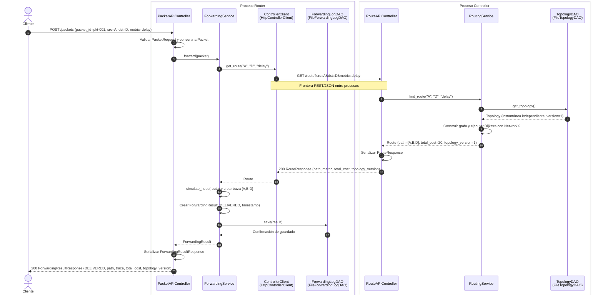
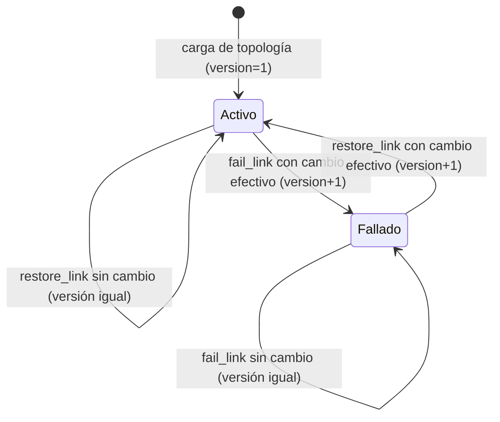
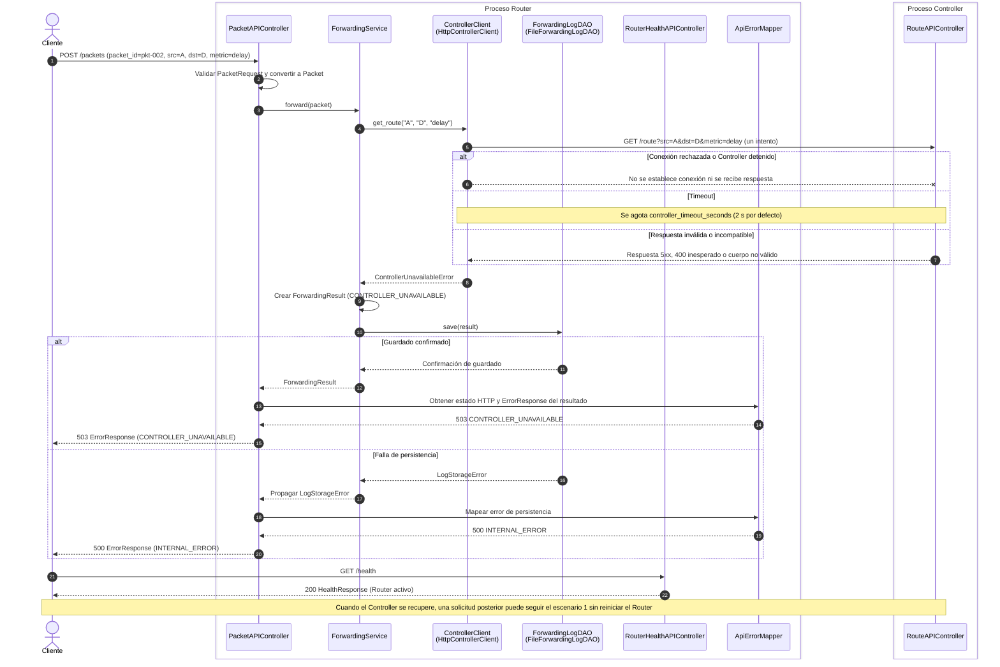

# 03 — Arquitectura dinámica

## Sistema educativo tipo SDN: Controller y Router

| Campo | Detalle |
| :---- | :---- |
| Proyecto | Aplicaciones Controller y Router comunicadas por REST/JSON (simulación a nivel de aplicación) |
| Documento | specs/03-dynamic-architecture.md |
| Versión | 1.2 |
| Fecha | 27 de octubre de 2026 |
| Estado | Línea base aprobada |
| Documentos base | 01-requirements.md v1.2 y 02-static-architecture.md v1.2 |
| Controller (Estudiante A) | Andrés Felipe Mateus |
| Router (Estudiante B) | Santiago Ramirez Chavarro |

---

## 1\. Introducción

### 1.1 Propósito

Este documento especifica las interacciones entre componentes en tiempo de ejecución para tres escenarios: reenvío exitoso de un paquete, falla y recuperación de un enlace, e indisponibilidad del Controller. Los diagramas se alinean con las clases, responsabilidades e interfaces de 02-static-architecture.md v1.2 y con las decisiones de 01-requirements.md v1.2.

El documento describe comportamiento y secuencias, no código de implementación. Los diagramas distinguen las llamadas internas de las interacciones HTTP entre los dos procesos. Controller y Router son aplicaciones Python independientes; no comparten memoria ni estado de dominio.

### 1.2 Relación con los demás documentos

| Documento | Relación |
| :---- | :---- |
| 01-requirements.md | Define los requisitos, casos de uso, decisiones de interpretación, estados HTTP y códigos de aplicación que deben respetarse. |
| 02-static-architecture.md | Define las clases, interfaces, responsabilidades, dependencias e implementaciones concretas utilizadas en las secuencias. |
| 04-api-contract.md | Debe formalizar los nombres y tipos de campos JSON, los esquemas de éxito/error y los códigos HTTP. Las llamadas HTTP de este documento deben coincidir con ese contrato. |
| 05-implementation-plan.md | Debe convertir las responsabilidades y secuencias en tareas de implementación verificables. |
| 06-test-specification.md | Debe formalizar los casos de prueba citados aquí. Los IDs de prueba se consideran referencias previstas hasta que el documento 06 los defina de forma inequívoca. |

### 1.3 Convenciones de notación

- Los diagramas están escritos en Mermaid (sequenceDiagram) con numeración automática de mensajes.  
- Las flechas continuas representan llamadas o mensajes; las discontinuas representan retornos o respuestas.  
- \--\>\> representa una respuesta o retorno. \--x representa un mensaje que no obtiene respuesta. Una excepción interna se representa como retorno de error al componente que la captura; no se dibuja como si fuera una respuesta HTTP.  
- Los bloques alt representan ramas alternativas excluyentes.  
- Los mensajes HTTP se escriben como MÉTODO /ruta. Las respuestas incluyen estado HTTP, esquema y campos relevantes.  
- Cuando una dependencia usa una interfaz, se muestra la interfaz y, entre paréntesis, la implementación activa en producción.  
- Los participantes se agrupan por proceso. El cliente es una persona, aplicación o script externo.  
- Los nombres de clases corresponden a 02-static-architecture.md v1.2: por ejemplo, PacketAPIController, RouteAPIController, TopologyAPIController, LinkAPIController, HealthAPIController (Controller) y RouterHealthAPIController (Router).  
- Los diagramas muestran una sola solicitud a la vez. Las operaciones concurrentes deben conservar las garantías de sincronización definidas en la arquitectura estática.

### 1.4 Topología de ejemplo

Todos los diagramas que muestran cálculo de rutas usan la siguiente topología ilustrativa. Las pruebas pueden utilizar otras topologías.

| Enlace | Retardo (ms) | Ancho de banda (Mbps) | Pérdida (p) |
| :---- | ----: | ----: | ----: |
| A-B | 10 | 100 | 0,01 |
| B-D | 10 | 100 | 0,01 |
| A-C | 15 | 50 | 0,02 |
| C-D | 20 | 50 | 0,02 |

Con la métrica delay, el camino mínimo de A a D es A-B-D, con costo total 20\. La alternativa A-C-D tiene costo 35\. La versión inicial de la topología es 1\.

La versión identifica el estado de la topología durante una ejecución del Controller. No se persiste en el archivo JSON ni garantiza unicidad entre ejecuciones distintas. Tras reiniciar el Controller, la topología se carga desde el archivo original, todos los enlaces comienzan activos y la versión vuelve a 1\.

---

## 2\. Participantes

| Alias | Clase / interfaz (02-static-architecture.md) | Proceso | Capa | Escenarios |
| :---- | :---- | :---- | :---- | :---- |
| C | Cliente HTTP | Externo | Actor | 1, 2, 3 |
| PC | PacketAPIController | Router | Controlador HTTP | 1, 3 |
| HRouter | RouterHealthAPIController (Router) | Router | Controlador HTTP | 3 |
| EM-R | ApiErrorMapper (Router) | Router | Manejo de errores HTTP | 1, 3 |
| FS | ForwardingService | Router | Servicio | 1, 3 |
| CC | ControllerClient (HttpControllerClient) | Router | Gateway / cliente HTTP | 1, 3 |
| FLD | ForwardingLogDAO (FileForwardingLogDAO) | Router | DAO | 1, 3 |
| RC | RouteAPIController | Controller | Controlador HTTP | 1, 2, 3 |
| TCtl | TopologyAPIController | Controller | Controlador HTTP | Contrato; sin diagrama propio |
| LC | LinkAPIController | Controller | Controlador HTTP | 2 |
| HController | HealthAPIController (Controller) | Controller | Controlador HTTP | Contrato; sin diagrama propio |
| EM-C | ApiErrorMapper (Controller) | Controller | Manejo de errores HTTP | 2 |
| RS | RoutingService | Controller | Servicio | 1, 2 |
| LMS | LinkManagementService | Controller | Servicio | 2 |
| TQS | TopologyQueryService | Controller | Servicio | Contrato; sin diagrama propio |
| TDAO | TopologyDAO (FileTopologyDAO) | Controller | DAO | 1, 2 |
| T | Topology | Controller | Modelo | 2 |

Los esquemas de vista (PacketRequest, RouteResponse, ForwardingResultResponse, LinkChangeRequest, LinkChangeResponse, ErrorResponse, HealthResponse y TopologyResponse) y los modelos (Packet, Route, ForwardingResult, LinkChangeResult) se representan como datos intercambiados o valores devueltos, no como participantes independientes.

Nota de nomenclatura: la interfaz es ControllerClient y su implementación de producción es HttpControllerClient; de forma análoga, las interfaces DAO son TopologyDAO y ForwardingLogDAO, con implementaciones FileTopologyDAO y FileForwardingLogDAO. Los servicios dependen de las interfaces, no de las implementaciones concretas.

---

## 3\. Escenario 1: reenvío de un paquete

| Elemento | Detalle |
| :---- | :---- |
| Objetivo | El Router valida la solicitud, obtiene una ruta del Controller, simula el reenvío e intenta registrar el resultado antes de responder. El escenario contempla el flujo exitoso, los errores esperados y las excepciones internas inesperadas. |
| Casos de uso | UC-01, UC-02 |
| Requisitos | FR-03, FR-04, FR-05, FR-07, FR-08, FR-09, FR-10, NFR-03, NFR-04 |
| Pruebas previstas | TX-37 y TX-62 para el reenvío exitoso. Los errores de ruta, nodo y persistencia se verifican mediante los casos correspondientes de `06-test-specification.md`, especialmente TX-41–TX-55 cuando aplique. |
| Precondición | Router y Controller activos; topología cargada en versión 1; todos los enlaces están administrativamente activos. |
| Postcondición del flujo exitoso | Se persiste un ForwardingResult con estado DELIVERED; el cliente recibe 200 con la ruta y traza A-B-D; la topología no cambia. |

3.1 Diagrama de secuencia



&nbsp;

### 3.2 Descripción por fases

| Fase | Qué ocurre | Requisitos relacionados |
| :---- | :---- | :---- |
| Validación y delegación | PacketAPIController valida el cuerpo y la métrica localmente, convierte la solicitud en Packet y delega en ForwardingService. Si la solicitud es inválida, devuelve 400 INVALID\_INPUT sin consultar al Controller ni registrar un resultado. | FR-08, FR-09, NFR-03 |
| Consulta de ruta | ForwardingService utiliza ControllerClient.get\_route(). HttpControllerClient emite una sola solicitud HTTP. RouteAPIController delega en RoutingService, que obtiene una instantánea mediante TopologyDAO y calcula la ruta. | FR-03, FR-04, FR-05, FR-07 |
| Simulación | El Router recorre la ruta recibida, salto a salto, sin esperas reales ni descartes aleatorios. La pérdida solo influye en el costo de enrutamiento; no produce pérdidas aleatorias durante la simulación. | FR-08, A-06 |
| Persistencia y respuesta | ForwardingService intenta guardar el resultado antes de que PacketAPIController responda. Si el guardado se confirma, devuelve el resultado. Si falla, se responde 500 INTERNAL\_ERROR y no se afirma que el registro quedó almacenado. | FR-10, NFR-04 |
| Manejo de excepciones internas | Si ocurre una excepción interna inesperada durante el procesamiento de una solicitud válida, el Router evita clasificarla como DELIVERED, registra el error sin exponer detalles internos al cliente y devuelve 500 INTERNAL\_ERROR. Cuando sea posible, intenta registrar un ForwardingResult con estado INTERNAL\_ERROR. Si falla la persistencia, no afirma que el resultado quedó almacenado. | FR-10, NFR-04 |

### 3.3 Variantes y errores

| ID | Punto de divergencia | Comportamiento | Respuesta HTTP al cliente | Registro |
| :---- | :---- | :---- | :---- | :---- |
| V1 | Validación de PacketRequest | Cuerpo JSON inválido, campos obligatorios ausentes o métrica no soportada detectados localmente. No se contacta al Controller. | 400 INVALID\_INPUT | No se crea ni intenta guardar un resultado. |
| V2 | ControllerClient.get\_route() | El Controller responde con un 404 NODE\_NOT\_FOUND válido. ForwardingService construye un resultado INVALID\_NODE y lo guarda antes de devolverlo. | 404 NODE\_NOT\_FOUND | Se intenta guardar INVALID\_NODE. |
| V3 | ControllerClient.get\_route() | El Controller responde con un 404 PATH\_NOT\_FOUND válido. ForwardingService construye un resultado NO\_ROUTE y lo guarda antes de devolverlo. | 404 PATH\_NOT\_FOUND | Se intenta guardar NO\_ROUTE. |
| V4 | RoutingService.find\_route() | Origen y destino son el mismo nodo existente. La ruta contiene un único nodo y costo 0\. | 200 | Se guarda DELIVERED. |
| V5 | Comunicación con Controller | Error de transporte, timeout, 400 inesperado, 5xx, JSON malformado o respuesta incompatible. Se trata como indisponibilidad, conforme a AD-10. | 503 CONTROLLER\_UNAVAILABLE | Se intenta guardar CONTROLLER\_UNAVAILABLE. |
| V6 | ForwardingLogDAO.save() | El almacenamiento falla, independientemente de que la simulación haya concluido o de que el Controller estuviera disponible. | 500 INTERNAL\_ERROR | No se puede confirmar el guardado. No se debe declarar persistido el resultado. |
| V7 | Procesamiento interno de ForwardingService\\ | Ocurre una excepción interna inesperada después de la validación local y antes de obtener un resultado de reenvío válido. Se registra el error técnico y se intenta guardar un ForwardingResult con estado INTERNAL\_ERROR, si se dispone de la información necesaria. Si también falla la persistencia, se registra ese fallo por separado. | 500 INTERNAL\_ERROR | Se intenta guardar INTERNAL\_ERROR. Si falla el almacenamiento, no se garantiza la persistencia del resultado. |

Regla de tratamiento de errores: ForwardingService transforma las condiciones de reenvío esperadas (INVALID\_NODE, NO\_ROUTE y CONTROLLER\_UNAVAILABLE) en ForwardingResult y solicita su persistencia. Las excepciones internas inesperadas durante el procesamiento de una solicitud válida se tratan como INTERNAL\_ERROR; no deben producir un resultado DELIVERED. Cuando sea posible, se intenta persistir el resultado fallido. Si la persistencia falla, el error de almacenamiento prevalece y la respuesta es 500 INTERNAL\_ERROR. El Router no debe afirmar que un resultado quedó persistido sin confirmación del repositorio.

---

## 4\. Escenario 2: falla y recuperación de un enlace

| Elemento | Detalle |
| :---- | :---- |
| Objetivo | Demostrar que fallar un enlace modifica el estado operativo y la versión de topología, cambia las rutas posteriores y que restaurarlo permite recuperar la ruta original. |
| Casos de uso | UC-01, UC-03, UC-04 |
| Requisitos | FR-03, FR-05, FR-06, FR-09, NFR-03, NFR-06 |
| Pruebas previstas | TX-25–TX-33 y TX-63–TX-65, según la operación y la condición comprobada. |
| Precondición | Controller activo en versión 1; el enlace B-D está activo y forma parte de la ruta A-B-D. |
| Postcondición | Después de fallar B-D, la versión pasa a 2 y la ruta usa A-C-D si sigue disponible. Al restaurar B-D, la versión pasa a 3 y vuelve a ser óptima A-B-D. |

Las consultas de ruta se muestran directamente contra el Controller para hacer explícita la evolución de la topología. Esas mismas consultas son las que emite HttpControllerClient durante un POST /packets. Un paquete enviado al Router después de una falla usa la ruta obtenida en su propia consulta; si no existe camino, el Router registra NO\_ROUTE y responde 404 PATH\_NOT\_FOUND.

### 4.1 Diagrama de secuencia

```mermaid
sequenceDiagram
    autonumber
    actor C as Cliente / operador
    box Proceso Controller
        participant RC as RouteAPIController
        participant RS as RoutingService
        participant LC as LinkAPIController
        participant LMS as LinkManagementService
        participant TDAO as TopologyDAO<br/>(FileTopologyDAO)
        participant T as Topology
        participant EM as ApiErrorMapper
    end

    C->>RC: GET /route?src=A&dst=D&metric=delay
    RC->>RS: find_route("A", "D", "delay")
    RS->>TDAO: get_topology()
    TDAO-->>RS: Topology (instantánea, version=1)
    RS->>RS: Construir grafo y ejecutar Dijkstra
    RS-->>RC: Route (A-B-D, total_cost=20, version=1)
    RC-->>C: 200 RouteResponse (path=[A,B,D], topology_version=1)

    C->>LC: POST /links/fail (node_a=B, node_b=D)
    LC->>LC: Validar LinkChangeRequest
    LC->>LMS: fail_link("B", "D")
    LMS->>TDAO: update_link_state("B", "D", false)
    Note over TDAO: Serializa la modificación con un bloqueo
    TDAO->>T: set_link_active("B", "D", false)
    alt El enlace existe y cambia de estado
        T-->>TDAO: LinkChangeResult (active=false, changed=true, version=2)
        TDAO-->>LMS: LinkChangeResult
        LMS-->>LC: LinkChangeResult
        LC-->>C: 200 LinkChangeResponse (active=false, changed=true, topology_version=2)
    else El enlace no existe
        TDAO-->>LMS: LinkNotFoundError
        LMS-->>LC: LinkNotFoundError
        LC->>EM: Mapear error de dominio
        EM-->>C: 404 ErrorResponse (LINK_NOT_FOUND)
    end

    C->>RC: GET /route?src=A&dst=D&metric=delay
    RC->>RS: find_route("A", "D", "delay")
    RS->>TDAO: get_topology()
    TDAO-->>RS: Topology (instantánea, version=2; B-D fallado)
    RS->>RS: Construir grafo solo con enlaces usables y ejecutar Dijkstra
    alt Existe una ruta alternativa
        RS-->>RC: Route (A-C-D, total_cost=35, version=2)
        RC-->>C: 200 RouteResponse (path=[A,C,D], topology_version=2)
    else No existe camino utilizable
        RS-->>RC: PathNotFoundError
        RC->>EM: Mapear error de dominio
        EM-->>C: 404 ErrorResponse (PATH_NOT_FOUND)
    end

    C->>LC: POST /links/restore (node_a=B, node_b=D)
    LC->>LC: Validar LinkChangeRequest
    LC->>LMS: restore_link("B", "D")
    LMS->>TDAO: update_link_state("B", "D", true)
    TDAO->>T: set_link_active("B", "D", true)
    alt El enlace existe y cambia de estado
        T-->>TDAO: LinkChangeResult (active=true, changed=true, version=3)
        TDAO-->>LMS: LinkChangeResult
        LMS-->>LC: LinkChangeResult
        LC-->>C: 200 LinkChangeResponse (active=true, changed=true, topology_version=3)
    else El enlace no existe
        TDAO-->>LMS: LinkNotFoundError
        LMS-->>LC: LinkNotFoundError
        LC->>EM: Mapear error de dominio
        EM-->>C: 404 ErrorResponse (LINK_NOT_FOUND)
    end

    C->>RC: GET /route?src=A&dst=D&metric=delay
    RC->>RS: find_route("A", "D", "delay")
    RS->>TDAO: get_topology()
    TDAO-->>RS: Topology (instantánea, version=3)
    RS->>RS: Construir grafo y ejecutar Dijkstra
    RS-->>RC: Route (A-B-D, total_cost=20, version=3)
    RC-->>C: 200 RouteResponse (path=[A,B,D], topology_version=3)
```

&nbsp;

### 4.2 Descripción por fases

| Fase | Qué ocurre | Requisitos relacionados |
| :---- | :---- | :---- |
| Consulta inicial | La topología de versión 1 contiene B-D activo; la ruta de menor retardo es A-B-D. | FR-03, FR-05 |
| Falla de enlace | LinkAPIController delega en LinkManagementService; el DAO coordina el cambio. Si el estado cambia efectivamente, topology\_version pasa de 1 a 2\. Un enlace inexistente produce 404 LINK\_NOT\_FOUND y no cambia la topología. | FR-06, FR-09 |
| Consulta posterior a la falla | RoutingService obtiene una nueva instantánea. El enlace fallado se excluye del grafo; devuelve la ruta alternativa o 404 PATH\_NOT\_FOUND si no hay camino. | FR-03, FR-06 |
| Restauración | El enlace vuelve a estar administrativamente activo. Si hubo cambio efectivo, la versión pasa de 2 a 3\. Un enlace inexistente produce 404 LINK\_NOT\_FOUND. | FR-06, FR-09 |
| Consulta posterior a la restauración | El enlace B-D vuelve a ser elegible, salvo que tenga p=1; con los datos del ejemplo, se recupera A-B-D. | FR-03, FR-06 |

### 4.3 Variantes

| ID | Punto de divergencia | Comportamiento | Respuesta |
| :---- | :---- | :---- | :---- |
| V1 | Validación de LinkChangeRequest | Cuerpo ausente, JSON inválido o extremos faltantes. No se invoca LinkManagementService. | 400 INVALID\_INPUT |
| V2 | TopologyDAO.update\_link\_state() | El enlace no existe. No se modifica el estado ni la versión. | 404 LINK\_NOT\_FOUND |
| V3 | Topology.set\_link\_active() | Fallar un enlace ya fallado o restaurar uno ya activo es idempotente. No aumenta la versión. | 200 LinkChangeResponse, changed=false |
| V4 | RoutingService.find\_route() | Tras la falla no existe ruta alternativa utilizable. | 404 PATH\_NOT\_FOUND |
| V5 | Estado del enlace con p=1 | Restaurar el enlace cambia su estado administrativo si estaba fallado, pero no lo vuelve utilizable para enrutamiento. | 200 para la restauración; el enlace sigue excluido del grafo |

### 4.4 Estados de un enlace



&nbsp;

Un enlace es utilizable para el cálculo de rutas solo si está activo y su probabilidad de pérdida es menor que 1\. Por tanto, el estado administrativo y la elegibilidad para el enrutamiento son conceptos relacionados, pero no idénticos: un enlace activo con p=1 continúa siendo inutilizable. La versión cambia solo cuando cambia efectivamente el estado administrativo activo/inactivo.

---

## 5\. Escenario 3: Controller no disponible

| Elemento | Detalle |
| :---- | :---- |
| Objetivo | El Router responde de forma controlada cuando no puede comunicarse con el Controller y mantiene disponible su endpoint de salud. |
| Casos de uso | UC-02, UC-06, UC-07 |
| Requisitos | FR-07, FR-09, FR-10, NFR-06, NFR-11 |
| Pruebas previstas | TX-45–TX-49, TX-57 y TX-66–TX-67, según la condición de indisponibilidad, persistencia, salud o recuperación comprobada. |
| Precondición | Router activo; Controller detenido, inalcanzable, con timeout o respondiendo con un cuerpo inválido/incompatible. |
| Postcondición del caso normal | Se intenta persistir un ForwardingResult con estado CONTROLLER\_UNAVAILABLE; si el guardado tiene éxito, el cliente recibe 503 y el Router sigue activo. Si el guardado falla, recibe 500 INTERNAL\_ERROR. |

El cliente HTTP del Router realiza un único intento, con timeout predeterminado de 2 segundos y sin reintentos automáticos. La prueba de resiliencia debe comprobar que POST /packets responde en el umbral definido por NFR-11 y que GET /health del Router no depende del Controller.

### 5.1 Diagrama de secuencia



&nbsp;

### 5.2 Descripción por fases

| Fase | Qué ocurre | Requisitos relacionados |
| :---- | :---- | :---- |
| Validación | PacketAPIController valida la solicitud. Si es inválida, responde 400 y no contacta al Controller; la indisponibilidad solo se evalúa para solicitudes válidas. | FR-08, FR-09 |
| Intento de consulta | HttpControllerClient realiza un solo intento. Error de transporte, timeout, respuesta incompatible, 400 inesperado o 5xx se convierten en ControllerUnavailableError. Los 404 NODE\_NOT\_FOUND y 404 PATH\_NOT\_FOUND válidos no se clasifican como indisponibilidad. | FR-07, FR-09, A-10 |
| Construcción y persistencia del resultado | ForwardingService crea CONTROLLER\_UNAVAILABLE e intenta guardarlo. No propaga la indisponibilidad como un error no controlado. Si falla el guardado, propaga LogStorageError. | FR-09, FR-10 |
| Respuesta HTTP | Si el guardado se confirma, PacketAPIController responde 503 CONTROLLER\_UNAVAILABLE. Si falla la persistencia, responde 500 INTERNAL\_ERROR. El límite de tiempo de NFR-11 debe verificarse mediante prueba, no asumirse solo por el timeout configurado. | NFR-06, NFR-11 |
| Comprobación de salud | GET /health consulta únicamente al RouterHealthAPIController del Router; no realiza una llamada al Controller. | A-08, NFR-06, NFR-11 |

### 5.3 Variantes

| ID | Punto de divergencia | Comportamiento | Respuesta HTTP |
| :---- | :---- | :---- | :---- |
| V1 | ForwardingLogDAO.save() | No puede guardarse el resultado CONTROLLER\_UNAVAILABLE. La persistencia fallida prevalece sobre el error de comunicación. | 500 INTERNAL\_ERROR |
| V2 | Recuperación del Controller | El Controller vuelve a estar disponible. No es necesario reiniciar el Router; una nueva solicitud realiza su propio intento HTTP. | La siguiente solicitud sigue el escenario 1 si tiene éxito |
| V3 | Respuesta válida 404 NODE\_NOT\_FOUND | El Router conserva el error de aplicación, registra un resultado INVALID\_NODE y no lo clasifica como indisponibilidad. | 404 NODE\_NOT\_FOUND |
| V4 | Respuesta válida 404 PATH\_NOT\_FOUND | El Router conserva el error de aplicación, registra un resultado NO\_ROUTE y no lo clasifica como indisponibilidad. | 404 PATH\_NOT\_FOUND |
| V5 | GET /health durante la caída del Controller | La salud del Router es independiente del Controller. | 200 HealthResponse mientras el propio Router pueda atender la solicitud |

---

## 6\. Reglas dinámicas e invariantes

| ID | Regla | Referencia |
| :---- | :---- | :---- |
| R-01 | Para cada paquete que supera la validación local, el Router realiza exactamente un intento de GET /route; para un paquete inválido no realiza ninguno. | A-07, A-10; requisitos de validación y reintentos |
| R-02 | El Router utiliza la ruta recibida del Controller sin recalcularla ni modificarla y no importa NetworkX ni ejecuta Dijkstra. | AD-06, AD-11 de 02-static-architecture.md |
| R-03 | Para cada paquete que supera la validación local, el Router debe crear un único `ForwardingResult` e intentar persistirlo antes de responder. Si ocurre una excepción interna inesperada durante el procesamiento, el Router debe intentar crear y persistir un resultado con estado `INTERNAL_ERROR`, siempre que disponga de la información necesaria para hacerlo. En ese caso, responde HTTP `500 INTERNAL_ERROR`, sin exponer detalles internos. Si la persistencia falla, responde HTTP `500 INTERNAL_ERROR` y no afirma que el resultado quedó almacenado. Las solicitudes que no superan la validación local no generan un resultado persistido. | A-07, FR-10, AD-09 |
| R-04 | Los controladores HTTP validan, delegan y construyen respuestas; no acceden directamente a los DAO ni ejecutan algoritmos de enrutamiento o simulación de saltos. | NFR-03, reglas de dependencia de 02-static-architecture.md |
| R-05 | topology\_version cambia solo cuando una operación de falla/restauración modifica efectivamente el estado del enlace. Cada Route informa la versión de la instantánea utilizada. | A-05, FR-06 |
| R-06 | Una falla o restauración afecta a las consultas que obtienen instantáneas después del cambio. Una solicitud que ya recibió una ruta continúa usando esa ruta; no se invalida ni recalcula en medio de la simulación. | A-06 |
| R-07 | FileTopologyDAO serializa las modificaciones concurrentes y devuelve instantáneas consistentes que no permiten mutar directamente el estado compartido. | AD-04, AD-12 |
| R-08 | Los errores esperados no terminan el proceso. GET /health debe seguir respondiendo 200 cuando la aplicación correspondiente está en ejecución y puede atender solicitudes. | NFR-06 |
| R-09 | El Router realiza un único intento al Controller con controller\_timeout\_seconds=2 por defecto. La meta de NFR-11 es responder dentro de 3 segundos; se verifica mediante pruebas de extremo a extremo, incluida la persistencia. | A-10, NFR-11 |
| R-10 | GET /health del Router no consulta al Controller. | A-08 |
| R-11 | GET /route debe cumplir p95 ≤ 200 ms en las condiciones de carga definidas en NFR-10: topología sintética conectada de al menos 50 nodos y 150 enlaces, 100 consultas por métrica, latencia HTTP completa y cálculo p95 por nearest-rank (muestra ordenada de rango ceil(0,95 × n)). | NFR-10 |

---

## 7\. Correspondencia con el contrato de API

Los nombres exactos de campos, tipos JSON y estructura completa de las respuestas deben fijarse en 04-api-contract.md. La tabla siguiente establece el comportamiento HTTP esperado conforme a 01-requirements.md v1.2.

| Interacción HTTP | Emisor | Receptor | Éxito | Errores esperados | Escenarios |
| :---- | :---- | :---- | :---- | :---- | :---- |
| POST /packets | Cliente | PacketAPIController (Router) | 200 ForwardingResultResponse para DELIVERED | 400 INVALID\_INPUT, 404 NODE\_NOT\_FOUND, 404 PATH\_NOT\_FOUND, 503 CONTROLLER\_UNAVAILABLE, 500 INTERNAL\_ERROR | 1, 3 |
| GET /route?src\&dst\&metric | HttpControllerClient o cliente externo | RouteAPIController (Controller) | 200 RouteResponse | 400 INVALID\_INPUT, 404 NODE\_NOT\_FOUND, 404 PATH\_NOT\_FOUND, 500 INTERNAL\_ERROR | 1, 2 |
| POST /links/fail | Cliente | LinkAPIController (Controller) | 200 LinkChangeResponse | 400 INVALID\_INPUT, 404 LINK\_NOT\_FOUND, 500 INTERNAL\_ERROR | 2 |
| POST /links/restore | Cliente | LinkAPIController (Controller) | 200 LinkChangeResponse | 400 INVALID\_INPUT, 404 LINK\_NOT\_FOUND, 500 INTERNAL\_ERROR | 2 |
| GET /health (Router) | Cliente | RouterHealthAPIController (Router) | 200 HealthResponse | No se define un error de aplicación para la indisponibilidad del Controller; si el Router no está en ejecución no habrá respuesta HTTP. | 3 |
| GET /health (Controller) | Cliente | HealthAPIController (Controller) | 200 HealthResponse | Si el Controller no está en ejecución, no habrá respuesta HTTP. | Fuera de los tres flujos principales |
| GET /topology | Cliente | TopologyAPIController (Controller) | 200 TopologyResponse | 500 INTERNAL\_ERROR | Contrato; no tiene diagrama propio |

### 7.1 Reglas de respuesta para POST /packets

* Si la solicitud no supera la validación local, se devuelve 400 INVALID\_INPUT. No se consulta al Controller ni se registra un resultado.  
* Si la consulta de ruta devuelve un error de aplicación válido 404 NODE\_NOT\_FOUND o 404 PATH\_NOT\_FOUND, se crea el ForwardingResult correspondiente (INVALID\_NODE o NO\_ROUTE) y se intenta persistir antes de responder. Tras confirmar el guardado, se devuelve el error HTTP correspondiente.  
* Si el Controller no está disponible o su respuesta es inválida o incompatible, se crea un ForwardingResult con estado CONTROLLER\_UNAVAILABLE y se intenta persistir antes de responder. Tras confirmar el guardado, se devuelve 503 CONTROLLER\_UNAVAILABLE.  
* Si el procesamiento determina un resultado de reenvío, se crea un único ForwardingResult y se intenta persistir antes de responder. Si la persistencia falla, se devuelve 500 INTERNAL\_ERROR. No se afirma que el resultado quedó guardado.  
* Si ocurre una excepción interna inesperada después de la validación local, se conserva o genera `packet_id`, se intenta crear y persistir un `ForwardingResult` con estado `INTERNAL_ERROR`, y se devuelve HTTP 500 `INTERNAL_ERROR` sin detalles internos. Si el DAO falla, se registra el fallo de persistencia por separado y no se afirma que el resultado quedó almacenado.  
* ForwardingStatus admite cinco estados: DELIVERED, INVALID\_NODE, NO\_ROUTE, CONTROLLER\_UNAVAILABLE e INTERNAL\_ERROR. El estado persistido INTERNAL\_ERROR y el código HTTP 500 INTERNAL\_ERROR comparten nombre, pero son conceptos distintos.  
* ForwardingResultResponse se utiliza para el éxito DELIVERED. Para los estados de error HTTP se utiliza ErrorResponse, salvo que 04-api-contract.md establezca explícitamente un esquema distinto y se actualice este documento de forma coordinada.  
* La presencia de packet\_id en ErrorResponse se rige por 04-api-contract.md. Si aparece en una respuesta 500 INTERNAL\_ERROR, identifica el paquete asociado cuando esté disponible, pero no garantiza que exista un resultado persistido.

### 7.2 Cadena de GET /topology y GET /health

GET /topology sigue la cadena TopologyAPIController.get\_topology() → TopologyQueryService.get\_topology() → TopologyDAO.get\_topology(), conforme a la arquitectura estática. No se modifica el estado de la topología.

Cada GET /health invoca únicamente al HealthAPIController del Controller o al RouterHealthAPIController del Router, según la aplicación consultada. La salud del Router no depende del Controller; la salud del Controller informa únicamente sobre el propio proceso Controller.

---

## 8\. Trazabilidad de escenarios a requisitos y pruebas

| Escenario | Casos de uso | Requisitos principales | Pruebas previstas |
| :---- | :---- | :---- | :---- |
| 1\. Reenvío de un paquete | UC-01, UC-02 | FR-03, FR-04, FR-05, FR-07, FR-08, FR-09, FR-10, NFR-03, NFR-04 | TX-37 y TX-62 para el reenvío exitoso; casos específicos de error y persistencia definidos en 06\. |
| 2\. Falla y recuperación de enlace | UC-03, UC-04 | FR-03, FR-05, FR-06, FR-09, NFR-03, NFR-06 | TX-25–TX-33 y TX-63–TX-65. |
| 3\. Controller no disponible | UC-02, UC-06, UC-07 | FR-07, FR-09, FR-10, NFR-06, NFR-11 | TX-45–TX-49, TX-57 y TX-66–TX-67. |

Los requisitos de carga y validación de topología, métricas, configuración, arquitectura y rendimiento (FR-01, FR-02, NFR-01, NFR-02, NFR-05, NFR-07 a NFR-10) requieren pruebas unitarias, estáticas o de rendimiento. Los identificadores de esas pruebas deben formalizarse en 06-test-specification.md; no se consideran pruebas definidas ni ejecutadas solo por aparecer citadas aquí.

Control de consistencia de IDs: el mismo ID de prueba no debe utilizarse para verificar condiciones incompatibles sin distinguir casos o subcasos. En particular, la ausencia de camino (PATH\_NOT\_FOUND) y la indisponibilidad del Controller (CONTROLLER\_UNAVAILABLE) son condiciones distintas y deben tener resultados de prueba diferenciados en el documento 06\.

---

## 9\. Verificación de consistencia

### 9.1 Con 02-static-architecture.md v1.2

- Los participantes internos corresponden a clases, interfaces o componentes definidos en la arquitectura estática. El cliente HTTP es un actor externo.  
- Se usan los nombres PacketAPIController, RouteAPIController, TopologyAPIController, LinkAPIController, HealthAPIController, ForwardingService, RoutingService, LinkManagementService, TopologyQueryService, ControllerClient, HttpControllerClient, TopologyDAO, FileTopologyDAO, ForwardingLogDAO y FileForwardingLogDAO.  
- Los métodos mostrados (forward, get\_route, find\_route, get\_topology, update\_link\_state, set\_link\_active, fail\_link, restore\_link, simulate\_hops y save) deben coincidir con el catálogo definitivo de métodos de 02-static-architecture.md. La serialización/deserialización de vistas se representa de forma conceptual, sin imponer métodos adicionales no definidos allí.  
- RoutingService calcula la ruta desde una instantánea consistente obtenida a través de TopologyDAO; ForwardingService simula el reenvío sin ejecutar Dijkstra.  
- Los servicios dependen de interfaces. Las implementaciones concretas aparecen en los diagramas para identificar los adaptadores utilizados en ejecución, no para sugerir que los servicios las instancien.  
- FileTopologyDAO coordina el acceso concurrente al estado; Topology.set\_link\_active() determina si el cambio de estado fue efectivo y actualiza la versión conforme a 02-static-architecture.md.  
- Los errores esperados del reenvío se representan como resultados de dominio que se intentan persistir. Un fallo de persistencia se propaga como LogStorageError hasta el límite HTTP y se transforma en 500 INTERNAL\_ERROR.

### 9.2 Con 01-requirements.md v1.2

- La topología es no dirigida; todos los enlaces comienzan activos al iniciar el Controller; topology\_version comienza en 1 y solo cambia con una modificación efectiva del estado administrativo.  
- Un enlace con p=1 no es utilizable para enrutamiento, aunque esté administrativamente activo.  
- delay, bandwidth y loss siguen las fórmulas y restricciones definidas en el documento 01\.  
- NODE\_NOT\_FOUND y PATH\_NOT\_FOUND son errores de aplicación válidos y se conservan en el Router. Los errores de transporte, timeout, respuestas inválidas/incompatibles, 400 inesperado y errores 5xx del Controller se clasifican como CONTROLLER\_UNAVAILABLE.  
- Una solicitud inválida se rechaza localmente con 400 INVALID\_INPUT, sin consulta al Controller ni intento de registro.  
- Un resultado de reenvío se intenta guardar antes de responder; si la persistencia falla, el resultado no se declara persistido y se devuelve 500 INTERNAL\_ERROR.  
- GET /health del Router es independiente del Controller. El timeout predeterminado del cliente HTTP es de 2 segundos, sin reintentos.  
- La meta de NFR-10 es p95 ≤ 200 ms bajo la carga especificada. La meta de NFR-11 debe verificarse de extremo a extremo; no se considera demostrada únicamente por configurar un timeout de 2 segundos.

### 9.3 Aspectos de contrato confirmados en 04-api-contract.md

1. Los nombres, tipos, obligatoriedad y valores predeterminados de los campos JSON quedan definidos en 04 v1.2.  
2. ErrorResponse permite `packet_id` según la regla de cada escenario; su presencia no confirma persistencia.  
3. ForwardingResultResponse se utiliza para el resultado exitoso DELIVERED.  
4. ForwardingStatus tiene cinco estados persistidos, incluido INTERNAL\_ERROR para excepción interna inesperada; los códigos HTTP y los estados de dominio son conceptos distintos.  
5. LinkChangeRequest, LinkChangeResponse, RouteResponse, TopologyResponse y HealthResponse quedan definidos en los esquemas de 04\.  
6. Los errores de validación se normalizan a 400 INVALID\_INPUT y no se exponen como 422\.  
7. CT-31 cubre el fallo de persistencia; CT-37 cubre la excepción interna inesperada en POST /packets. Ambos responden HTTP 500 INTERNAL\_ERROR, pero solo CT-37 intenta persistir un resultado con estado INTERNAL\_ERROR.

---

## 10\. Control de cambios y aprobación

### 10.1 Registro de versiones

| Versión | Fecha | Descripción | Autores |
| :---- | :---- | :---- | :---- |
| 1.0 | 20 de octubre de 2026 | Versión inicial para revisión cruzada. | A. F. Mateus, S. Cavarro |
| 1.1 | 22 de octubre de 2026 | Alineación con 01-requirements.md v1.1 y 02-static-architecture.md v1.1; corrección de nombres de clases, tratamiento de errores del Router, persistencia, versionado de topología y trazabilidad de pruebas. | A. F. Mateus, S. Cavarro |
| 1.2 | 27 de octubre de 2026 | INTERNAL\_ERROR, trazabilidad TX/TC y aprobación de línea base. | A. F. Mateus, S. Cavarro |

### 10.2 Registro de cambios posteriores al congelamiento

| ID | Fecha | Motivo | Artefactos afectados | Aprobado |
| :---- | :---- | :---- | :---- | :---- |
| CH-02 | 27 de octubre de 2026 | Se incorpora INTERNAL\_ERROR como quinto estado y se separa del fallo de persistencia y del HTTP 500\. | 01, 02, 03, 04, 05, 06 | Aprobado, 27 de octubre de 2026 — ambos integrantes |
| CH-03 | 27 de octubre de 2026 | Línea base, configuración, umbrales y cálculo p95 por nearest-rank aprobados; pruebas no declaradas ejecutadas. | 01, 02, 03, 04, 05, 06 | Aprobado, 27 de octubre de 2026 — ambos integrantes |
| CH-04 | 27 de octubre de 2026 | Trazabilidad alineada a TX detallados y TC-01 a TC-09 del PDF. | 01, 03, 04, 05, 06 | Aprobado, 27 de octubre de 2026 — ambos integrantes |
| CH-05 | 27 de octubre de 2026 | Correcciones de consistencia editorial y de referencias. | 03, 04, 05, 06 | Aprobado, 27 de octubre de 2026 |

### 10.3 Aprobación de la línea base

| Integrante | Rol | Confirmación | Fecha |
| :---- | :---- | :---- | :---- |
| Andrés Felipe Mateus | Controller | Aprobado, 27 de octubre de 2026 | 27 de octubre de 2026 |
| Santiago Ramirez Chavarro | Router | Aprobado, 27 de octubre de 2026 | 27 de octubre de 2026 |

Estado del documento: versión 1.2, línea base aprobada el 27 de octubre de 2026\. La aprobación documental no implica que las pruebas se hayan ejecutado.
