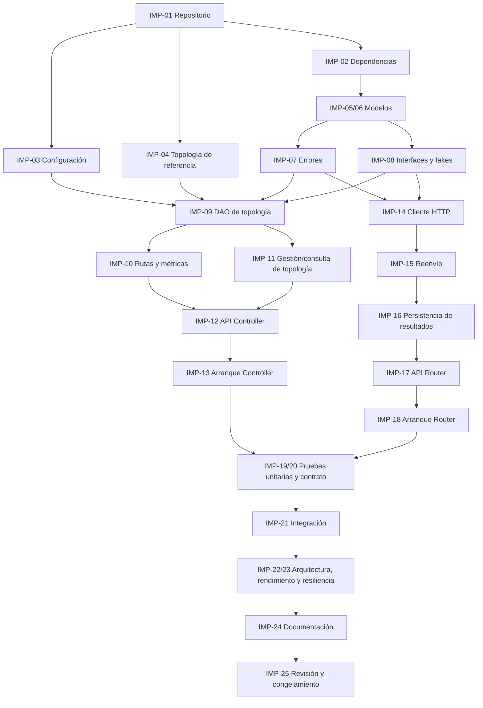

# 05 — Plan de implementación

## Sistema educativo tipo SDN: Controller y Router

| Campo | Detalle |
| :---- | :---- |
| Proyecto | Aplicaciones Controller y Router comunicadas por REST/JSON (simulación a nivel de aplicación) |
| Documento | `specs/05-implementation-plan.md` |
| Versión | 1.1 — línea base aprobada |
| Fecha | 27 de octubre de 2026 |
| Estado | Línea base aprobada; no implica implementación ni pruebas ejecutadas |
| Documentos base | `01-requirements.md` v1.2, `02-static-architecture.md` v1.2, `03-dynamic-architecture.md` v1.2 y `04-api-contract.md` v1.2 |
| Controller (Estudiante A) | Andrés Felipe Mateus |
| Router (Estudiante B) | Santiago Ramirez Chavarro |

---

## 1\. Propósito y alcance

Este documento convierte los requisitos, la arquitectura estática, la arquitectura dinámica y el contrato API en tareas de implementación pequeñas, ordenadas y verificables. Define responsables, dependencias, componentes afectados, criterios de finalización y evidencia esperada para la revisión de código y las pruebas.

El plan no afirma que el código esté implementado ni que las pruebas se hayan ejecutado. Los identificadores de pruebas automatizadas definitivos deben quedar definidos en `06-test-specification.md`; hasta entonces, este documento describe la evidencia que se debe producir, sin inventar identificadores `TC`.

### 1.1 Dentro del alcance

- Preparación del repositorio, entorno Python y configuración.  
- Implementación de modelos, errores, interfaces DAO y adaptadores de infraestructura.  
- Carga y validación de topología, métricas y cálculo de rutas en el Controller.  
- API REST del Controller para rutas, topología, enlaces y salud.  
- Cliente HTTP, simulación de reenvío, registro de resultados y API del Router.  
- Normalización de errores, persistencia basada en archivos e inyección de dependencias.  
- Pruebas unitarias, de integración, de contrato, arquitectónicas, de resiliencia y rendimiento.  
- Demostración integrada y revisión cruzada de los entregables.

### 1.2 Fuera del alcance

No se implementan OpenFlow, tráfico de red real, interfaz gráfica, autenticación/autorización, base de datos, múltiples Routers concurrentes como escenario requerido ni pérdida aleatoria de paquetes. El estado de falla/restauración de enlaces vive en memoria y no se escribe de vuelta en el archivo de topología.

### 1.3 Principios de implementación

1. Controller y Router se ejecutan como procesos independientes y se comunican exclusivamente mediante REST/JSON.  
2. El Controller es la única autoridad de topología y cálculo de rutas. El Router nunca implementa Dijkstra ni usa NetworkX para calcular rutas.  
3. Los controladores HTTP validan, delegan y serializan; no contienen lógica de dominio.  
4. Los servicios dependen de interfaces (`TopologyDAO`, `ControllerClient`, `ForwardingLogDAO`), no de implementaciones concretas.  
5. Las implementaciones concretas se crean en el `Composition Root` de cada aplicación.  
6. Los errores esperados se manejan sin terminar el proceso. Los errores de inicialización que impiden cargar una topología válida sí impiden iniciar el Controller.  
7. Un intento de persistencia no equivale a persistencia confirmada. Si el DAO falla, se devuelve `500 INTERNAL_ERROR` sin afirmar que el resultado quedó guardado.  
8. Los cinco estados persistidos de `ForwardingStatus` son `DELIVERED`, `INVALID_NODE`, `NO_ROUTE`, `CONTROLLER_UNAVAILABLE` e `INTERNAL_ERROR`. El estado persistido `INTERNAL_ERROR` clasifica una excepción interna inesperada; el código HTTP 500 `INTERNAL_ERROR` es un concepto distinto. El fallo de persistencia se trata por separado.

---

## 2\. Análisis de los entregables 01 a 04

Esta sección fija los puntos de partida usados para construir el plan y las restricciones que no se deben contradecir durante la implementación.

### 2.1 Entregable 01 — Requisitos de software

- Dos aplicaciones Python 3.11 o superior, ejecutadas en procesos separados.  
- Frameworks y herramientas previstas: FastAPI, Uvicorn, NetworkX, pytest y cliente HTTP.  
- El Controller carga y valida un archivo JSON; los enlaces son no dirigidos, comienzan activos y `topology_version` comienza en `1`.  
- Métricas: `delay = d`, `bandwidth = 1/b` y `loss = -ln(1-p)`. Los costos deben ser no negativos; enlaces con `p = 1` no son elegibles para ninguna ruta.  
- El Controller calcula rutas con Dijkstra; el Router consulta `GET /route` y simula la ruta recibida sin recalcularla.  
- Falla/restauración es idempotente: solo un cambio efectivo aumenta la versión. El estado operativo no se persiste en el JSON de topología.  
- El Router intenta registrar un resultado por cada paquete que supera la validación local; una solicitud inválida no genera registro.  
- El archivo de resultados es configurable; las pruebas pueden sustituirlo por un DAO en memoria.  
- Valores por fijar en este plan: puertos, rutas predeterminadas de archivos y dirección base del Controller. El timeout predeterminado del cliente HTTP es 2 segundos y no hay reintentos automáticos.  
- NFR-10 (p95 ≤ 200 ms para `GET /route` bajo la carga especificada) y NFR-11 (respuesta de `POST /packets` en ≤ 3 segundos ante la caída del Controller) fueron aprobados por ambos integrantes el 27 de octubre de 2026\.

### 2.2 Entregable 02 — Arquitectura estática

La implementación debe respetar MVC, servicios de dominio, DAO, inyección de dependencias y el patrón Strategy para las métricas.

**Controller:** `Topology`, `Link`, `Route`, `LinkChangeResult`, `CostMetric`, `DelayMetric`, `InverseBandwidthMetric`, `LossMetric`, `ControllerViewSchemas`, `RouteAPIController`, `TopologyAPIController`, `LinkAPIController`, `HealthAPIController`, `RoutingService`, `LinkManagementService`, `TopologyQueryService`, `TopologyDAO`, `FileTopologyDAO` y `ApiErrorMapper`.

**Router:** `Packet`, `ForwardingResult`, `RouterViewSchemas`, `PacketAPIController`, `RouterHealthAPIController`, `ForwardingService`, `ControllerClient`, `HttpControllerClient`, `ForwardingLogDAO`, `FileForwardingLogDAO` y `ApiErrorMapper`.

`RoutingService` obtiene una instantánea consistente de la topología y construye el grafo para cada consulta. `FileTopologyDAO` coordina las modificaciones concurrentes y las instantáneas. `Topology.set_link_active()` cambia el estado y la versión únicamente cuando el estado cambia efectivamente. `ForwardingService` solicita la ruta al cliente inyectado, simula los saltos y solicita guardar el resultado mediante el DAO.

### 2.3 Entregable 03 — Arquitectura dinámica

La secuencia principal exige: validar el paquete localmente; realizar exactamente una consulta al Controller por paquete válido; validar la respuesta de ruta; simular la traza; construir un único resultado; intentar persistirlo; responder solo después de conocer el resultado de la persistencia.

- Entrada inválida: `400 INVALID_INPUT`, sin llamada al Controller ni registro.  
- Nodo inexistente: `404 NODE_NOT_FOUND`, con intento de persistencia de `INVALID_NODE`.  
- Sin camino utilizable: `404 PATH_NOT_FOUND`, con intento de persistencia de `NO_ROUTE`.  
- Transporte fallido, timeout o respuesta inválida/incompatible: `503 CONTROLLER_UNAVAILABLE`, con intento de persistencia del estado homónimo.  
- Fallo al guardar: `500 INTERNAL_ERROR`; no se declara persistido el resultado.  
- El Router sigue disponible ante la caída del Controller y su `GET /health` no depende de aquel.  
- Las rutas son instantáneas: un cambio posterior de enlace afecta consultas siguientes, no modifica una ruta que ya fue devuelta para un paquete en curso.

### 2.4 Entregable 04 — Contrato de API

La implementación debe seguir los métodos, rutas, campos, tipos, códigos HTTP y esquemas de la versión aprobada de `04-api-contract.md`. Los campos JSON usan `snake_case`; los errores se devuelven en JSON. Los errores de validación se normalizan a `400 INVALID_INPUT`, no a `422`.

El esquema `ErrorResponse (Router)` permite `packet_id` como propiedad opcional; el contrato establece cuándo se incluye. Su presencia no demuestra que se haya persistido un resultado. Las solicitudes rechazadas localmente con `400 INVALID_INPUT` no deben incluirlo ni generar registro; los errores posteriores a la validación local deben seguir la regla de presencia definida en el contrato.

### 2.5 Controles de consistencia de la línea base

Durante la implementación, verificar en conjunto estos criterios de conformidad:

1. Que 01 a 06 mantengan los cinco estados de ForwardingStatus y distingan `INTERNAL_ERROR` persistido del código HTTP 500 y del fallo de persistencia.  
2. Que 04 defina inequívocamente la presencia de `packet_id` en cada respuesta de error de `POST /packets`; el esquema por sí solo solo permite el campo, no establece cuándo es obligatorio.  
3. Que las rutas, esquemas y códigos HTTP implementados coincidan con 04 y que 03 use los mismos nombres y contratos.  
4. Que los nombres de componentes sean los de 02: `FileTopologyDAO`, `LinkManagementService` y `TopologyQueryService`, entre otros.  
5. Que los umbrales aprobados de NFR-10 y NFR-11 se verifiquen mediante pruebas ejecutadas y evidencia documentada.  
6. Que todos los documentos utilicen los IDs definitivos TX-01 a TX-69 para casos detallados y TC-01 a TC-09 para los casos de aceptación del PDF, conforme a las matrices de 06\.

---

## 3\. Decisiones de implementación y configuración

### 3.1 Configuración inicial aprobada

Los valores siguientes fueron aprobados por ambos integrantes el 27 de octubre de 2026 para que la implementación arranque de forma reproducible. La configuración se lee mediante variables de entorno, cuyos nombres corresponden a las claves de la tabla en mayúsculas; todos los parámetros pueden sobrescribirse sin modificar el código.

| Parámetro | Aplicación | Valor predeterminado aprobado | Regla |
| :---- | :---- | :---- | :---- |
| `controller_host` | Controller | `127.0.0.1` | Configurable para ejecución local; documentar si se usa otra interfaz. |
| `controller_port` | Controller | `8001` | Puerto configurable. |
| `router_host` | Router | `127.0.0.1` | Configurable para ejecución local; documentar si se usa otra interfaz. |
| `router_port` | Router | `8002` | Puerto configurable. |
| `topology_file_path` | Controller | `data/topology.json` | Ruta relativa a la raíz del proyecto o ruta absoluta configurable. |
| `controller_base_url` | Router | `http://127.0.0.1:8001` | Debe coincidir con host/puerto efectivos del Controller. |
| `controller_timeout_seconds` | Router | `2` | Un único intento; sin reintentos automáticos. |
| `forwarding_log_path` | Router | `logs/forwarding.jsonl` | Crear directorio/archivo según política definida; errores de escritura deben producir `500`. |
| `log_level` | Ambas | `INFO` | Configurable; no registrar secretos ni datos internos sensibles. |

El formato del registro es JSON Lines (un objeto JSON por línea), conforme a 04-api-contract.md. Los nombres de variables de entorno son `CONTROLLER_HOST`, `CONTROLLER_PORT`, `ROUTER_HOST`, `ROUTER_PORT`, `TOPOLOGY_FILE_PATH`, `CONTROLLER_BASE_URL`, `CONTROLLER_TIMEOUT_SECONDS`, `FORWARDING_LOG_PATH` y `LOG_LEVEL`. La lectura de registros es interna; no implica un endpoint HTTP público para consultarlos.

### 3.2 Dependencias y entorno

- Python 3.11 o superior.  
- FastAPI y Uvicorn para las APIs.  
- NetworkX únicamente en el Controller.  
- `pytest` para pruebas.  
- Un cliente HTTP compatible con timeout configurable para `HttpControllerClient`.  
- Herramienta de validación/linting opcional si el equipo la adopta y documenta en el repositorio.

Las versiones exactas de dependencias deben fijarse en `requirements.txt` o el archivo de gestión de dependencias elegido. Ambos integrantes deben usar el mismo archivo y registrar el comando de instalación.

### 3.3 Estructura de carpetas objetivo

```
project/
├── controller/
│   ├── app.py
│   ├── config.py
│   ├── views/schemas.py
│   ├── controllers/
│   │   ├── route_controller.py
│   │   ├── topology_controller.py
│   │   ├── link_controller.py
│   │   └── health_controller.py
│   ├── services/
│   │   ├── routing_service.py
│   │   └── topology_service.py
│   ├── domain/
│   │   ├── models.py
│   │   ├── metrics.py
│   │   └── errors.py
│   ├── dao/
│   │   ├── interfaces.py
│   │   └── file_topology_dao.py
│   └── api_error_mapper.py
├── router/
│   ├── app.py
│   ├── config.py
│   ├── views/schemas.py
│   ├── controllers/
│   │   ├── packet_controller.py
│   │   └── health_controller.py
│   ├── services/forwarding_service.py
│   ├── domain/
│   │   ├── models.py
│   │   └── errors.py
│   ├── clients/
│   │   ├── interfaces.py
│   │   └── http_controller_client.py
│   ├── dao/
│   │   ├── interfaces.py
│   │   └── file_forwarding_log_dao.py
│   └── api_error_mapper.py
├── data/topology.json
├── logs/                     # generado al ejecutar, si corresponde
├── tests/
│   ├── unit/
│   ├── integration/
│   ├── contract/
│   └── architecture/
├── requirements.txt
└── README.md
```

La estructura concreta puede ajustarse si se conserva la separación de responsabilidades y se actualizan los documentos. El archivo `data/topology.json` debe ser un ejemplo válido de la topología de referencia; el código no debe modificarlo durante fallas/restauraciones.

---

## 4\. Fases de trabajo

| Fase | Objetivo | Resultado verificable | Condición para avanzar |
| :---- | :---- | :---- | :---- |
| F0. Línea base y repositorio | Confirmar decisiones, estructura y configuración. | Repositorio, dependencias y README inicial. | Ambos revisan contratos y responsables. |
| F1. Dominio e infraestructura base | Implementar modelos, errores e interfaces/fakes. | Modelos e interfaces probados sin HTTP ni archivos reales cuando corresponda. | Pruebas unitarias iniciales aprobadas. |
| F2. Controller | Implementar topología, métricas, rutas y API. | Controller arranca con topología válida y expone endpoints del contrato. | Pruebas de dominio y contrato del Controller aprobadas. |
| F3. Router | Implementar cliente HTTP, reenvío, registro y API. | Router consulta Controller, registra resultados y clasifica errores. | Pruebas unitarias del Router aprobadas. |
| F4. Integración y consistencia | Ejecutar ambos procesos y validar errores/contrato. | Pruebas de extremo a extremo y revisión de arquitectura. | Sin discrepancias críticas entre 01–04 y código. |
| F5. Calidad, demostración y entrega | Ejecutar resiliencia, rendimiento, documentación y demostración. | Resultados reproducibles, README y revisión final. | Evidencia archivada y aprobación de ambos integrantes. |

---

## 5\. Catálogo de tareas de implementación

Los IDs `IMP-xx` son los identificadores definitivos de tareas de este documento. Los casos de prueba `TC` se asignarán en el entregable 06; las referencias de verificación de esta tabla son descripciones de evidencia, no IDs de prueba.

### 5.1 Preparación y configuración

| ID | Tarea | Responsable | Dependencias | Componentes / artefactos | Criterio de finalización |
| :---- | :---- | :---- | :---- | :---- | :---- |
| IMP-01 | Crear la estructura del repositorio, paquetes Controller/Router y carpetas de pruebas. | Ambos | Ninguna | Repositorio, paquetes y `README.md` | Los dos paquetes se importan de forma independiente y no comparten estado de dominio. |
| IMP-02 | Fijar dependencias y comandos de instalación/ejecución. | Ambos | IMP-01 | `requirements.txt`, README | Una instalación limpia reproduce el entorno con Python 3.11 o superior. |
| IMP-03 | Implementar configuración externa para puertos, URL del Controller, timeout y rutas de archivos. | Ambos; cada estudiante en su aplicación | IMP-01 | `controller/config.py`, `router/config.py` y Composition Roots | Se pueden cambiar parámetros sin editar lógica de negocio; se validan valores inválidos al arrancar. |
| IMP-04 | Preparar topología JSON de referencia y documentar formato/rutas predeterminadas. | Controller — Andrés Felipe Mateus | IMP-01 | `data/topology.json`, README | El archivo pasa la validación y permite demostrar las tres métricas y una ruta alternativa tras fallar un enlace. |

### 5.2 Dominio e interfaces

| ID | Tarea | Responsable | Dependencias | Componentes / artefactos | Criterio de finalización |
| :---- | :---- | :---- | :---- | :---- | :---- |
| IMP-05 | Implementar modelos del Controller y validaciones de dominio. | Controller — Andrés Felipe Mateus | IMP-01 | `Topology`, `Link`, `Route`, `LinkChangeResult` | Se respetan unicidad, enlaces no dirigidos, rangos de atributos, inicialización activa y versión inicial `1`. |
| IMP-06 | Implementar modelos del Router y enumeración de estados. | Router — Santiago Ramirez Chavarro | IMP-01 | `Packet`, `ForwardingResult`, `ForwardingStatus` | `ForwardingStatus` contiene exactamente cinco estados: `DELIVERED`, `INVALID_NODE`, `NO_ROUTE`, `CONTROLLER_UNAVAILABLE` e `INTERNAL_ERROR`. |
| IMP-07 | Implementar errores de dominio y reglas de clasificación. | Ambos | IMP-05, IMP-06 | Errores de dominio de ambas aplicaciones, `ApiErrorMapper` (estructura inicial) | Los errores de entrada, nodo, ruta, Controller y almacenamiento se distinguen sin depender de detalles de FastAPI. |
| IMP-08 | Definir interfaces DAO y cliente HTTP, y fakes de prueba. | Ambos; cada estudiante en su aplicación | IMP-05, IMP-06 | `TopologyDAO`, `ForwardingLogDAO`, `ControllerClient`, fakes/in-memory | Los servicios pueden construirse con dependencias sustitutas; ninguna interfaz depende de una implementación concreta. |

5.3 Controller

| ID | Tarea | Responsable | Dependencias | Componentes / artefactos | Criterio de finalización |
| :---- | :---- | :---- | :---- | :---- | :---- |
| IMP-09 | Implementar carga, validación y acceso sincronizado a topología mediante DAO de archivo. | Controller — Andrés Felipe Mateus | IMP-03, IMP-04, IMP-05, IMP-08 | `FileTopologyDAO` | Rechaza JSON inválido, nodos/enlaces inválidos, duplicados y rangos fuera de regla; devuelve instantáneas independientes y coordina cambios concurrentes. |
| IMP-10 | Implementar estrategias de costo y cálculo de ruta con Dijkstra/NetworkX. | Controller — Andrés Felipe Mateus | IMP-05, IMP-08, IMP-09 | `CostMetric`, `DelayMetric`, `InverseBandwidthMetric`, `LossMetric`, `RoutingService` | Calcula ruta y costo con las tres métricas; excluye enlaces inactivos y enlaces con `p=1`; no depende de HTTP ni de archivos directamente. |
| IMP-11 | Implementar servicio de falla/restauración y consulta de topología. | Controller — Andrés Felipe Mateus | IMP-05, IMP-09 | `LinkManagementService`, `TopologyQueryService` | Falla/restauración afecta ambos sentidos; la versión solo aumenta ante cambios efectivos; `GET /topology` no modifica estado. |
| IMP-12 | Implementar esquemas de vista, controladores HTTP y mapeo de errores del Controller. | Controller — Andrés Felipe Mateus | IMP-07, IMP-09, IMP-10, IMP-11 | `ControllerViewSchemas`, `RouteAPIController`, `TopologyAPIController`, `LinkAPIController`, `HealthAPIController`, `ApiErrorMapper` | Implementa exactamente los endpoints y respuestas definidos en 04; errores de validación responden `400 INVALID_INPUT`, no `422`. |
| IMP-13 | Ensamblar y arrancar el proceso Controller. | Controller — Andrés Felipe Mateus | IMP-03, IMP-09–IMP-12 | `controller/app.py`, Uvicorn | Arranca con configuración válida; si el archivo de topología no existe o es inválido, termina con código distinto de cero y mensaje descriptivo. |

### 5.4 Router

| ID | Tarea | Responsable | Dependencias | Componentes / artefactos | Criterio de finalización |
| :---- | :---- | :---- | :---- | :---- | :---- |
| IMP-14 | Implementar cliente HTTP al Controller y validación estricta de respuestas. | Router — Santiago Ramirez Chavarro | IMP-03, IMP-07, IMP-08, contrato 04 | `HttpControllerClient` | Hace un solo intento con timeout configurable; conserva `404 NODE_NOT_FOUND` y `404 PATH_NOT_FOUND` válidos; transforma transporte, timeout, `400` inesperado, `5xx` y respuestas inválidas/incompatibles en `CONTROLLER_UNAVAILABLE`. |
| IMP-15 | Implementar simulación de saltos y construcción de resultado. | Router — Santiago Ramirez Chavarro | IMP-06, IMP-08, IMP-14 | `ForwardingService`, `Packet`, `ForwardingResult` | Utiliza exactamente la ruta recibida; la traza coincide con el orden de la ruta; no usa NetworkX ni calcula caminos. Origen=destino produce traza de un nodo y costo cero si el Controller devuelve la ruta válida. |
| IMP-16 | Implementar persistencia de resultados y tratamiento de fallos del DAO. | Router — Santiago Ramirez Chavarro | IMP-06, IMP-08, IMP-15 | `FileForwardingLogDAO`, `ForwardingLogDAO` | Guarda un registro por resultado de paquete válido; errores de almacenamiento generan `LogStorageError`; no se reporta éxito de persistencia cuando el guardado falla. El archivo se crea al primer guardado si esa es la política adoptada. |
| IMP-17 | Implementar esquemas, endpoints HTTP y mapeo de errores del Router. | Router — Santiago Ramirez Chavarro | IMP-07, IMP-14–IMP-16, contrato 04 | `RouterViewSchemas`, `PacketAPIController`, `RouterHealthAPIController`, `ApiErrorMapper` | `POST /packets` y `GET /health` cumplen 04; validación local inválida no consulta Controller ni registra; persistencia fallida devuelve `500 INTERNAL_ERROR`. |
| IMP-18 | Ensamblar y arrancar el proceso Router. | Router — Santiago Ramirez Chavarro | IMP-03, IMP-14–IMP-17 | `router/app.py`, Uvicorn | Arranca con configuración válida; el cliente HTTP, el DAO y los servicios se instancian en el Composition Root y se inyectan. |

5.5 Integración, calidad y entrega

| ID | Tarea | Responsable | Dependencias | Componentes / artefactos | Criterio de finalización |
| :---- | :---- | :---- | :---- | :---- | :---- |
| IMP-19 | Ejecutar pruebas unitarias de dominio, servicios y DAO con fakes. | Ambos | IMP-05–IMP-18 según componente | `tests/unit/` | Ejecutar TX-01–TX-17, TX-34, TX-50–TX-55 y TX-60; registrar también la cobertura de taller TC-01, TC-02, TC-08 y TC-09 según la tabla de equivalencia de 06\. |
| IMP-20 | Ejecutar pruebas de contrato para todos los endpoints y errores. | Ambos | IMP-12, IMP-17, 04 y 06 | `tests/contract/` | Cada endpoint del contrato tiene pruebas de método, estado HTTP, campos requeridos, tipos y código de aplicación. Los IDs se vinculan con TX-18–TX-30, TX-35, TX-37–TX-49 y TX-69 en 06\. |
| IMP-21 | Ejecutar pruebas de integración de los dos procesos. | Ambos | IMP-13, IMP-18, IMP-19, IMP-20 | `tests/integration/` | Ejecutar TX-31–TX-33, TX-57–TX-58 y TX-61–TX-68; vincular reenvío HTTP, traza, falla/restauración y resiliencia con TC-03–TC-07 de 06\. |
| IMP-22 | Ejecutar controles arquitectónicos y revisión estática. | Ambos | IMP-13, IMP-18 | `tests/architecture/`, revisión de código | No hay Dijkstra/NetworkX en Router; controladores no implementan algoritmos; servicios no acceden a archivos ni instancian DAOs concretos. |
| IMP-23 | Medir rendimiento y resiliencia conforme a NFR-10/NFR-11. | Controller: Andrés; Router: Santiago; revisión conjunta | IMP-21, CH-03 | Resultados reproducibles, `test-results.txt` | Se documentan entorno, topología, muestras, percentiles, latencias y resultados frente a los umbrales aprobados; el p95 usa nearest-rank. |
| IMP-24 | Completar README, instrucciones de demostración y matriz de trazabilidad. | Ambos | IMP-01–IMP-23, 01–06 | `README.md`, 01 sección 6, 05, 06 | Otra persona puede instalar, configurar, arrancar y demostrar el sistema siguiendo instrucciones reproducibles; cada FR/NFR tiene tarea y evidencia asociada. |
| IMP-25 | Realizar revisión cruzada y congelamiento de la línea base. | Ambos | IMP-20–IMP-24 | Documentos 01–06 y registro de cambios | Se cierran discrepancias documentales, se confirman IDs de prueba y se mantiene la aprobación de ambos integrantes; la evidencia de ejecución se registra por separado. |

---

## 6\. Orden de ejecución y dependencias

El trabajo puede desarrollarse en paralelo por aplicación después de acordar las interfaces y el contrato. Las dependencias del catálogo de tareas son obligatorias; el orden dentro de una misma fase puede ajustarse si no se rompe la arquitectura.



&nbsp;

### 6.1 Integración temprana recomendada

Cuando Controller y Router tengan una versión mínima ejecutable, realizar una integración temprana con una sola ruta conocida. No esperar a terminar todos los casos de error para verificar que `HttpControllerClient` y `GET /route` comparten exactamente los campos y tipos definidos en 04\. Luego ampliar a errores, persistencia, falla/restauración y resiliencia.

### 6.2 Gestión de cambios

Un cambio de contrato, modelo, nombre de componente o clasificación de error debe actualizar, como mínimo, los documentos y tareas afectados de 01 a 06\. No se debe resolver una discrepancia únicamente en código. Registrar el motivo, los artefactos afectados, el responsable y la aprobación de ambos integrantes.

---

## 7\. Matriz de trazabilidad de requisitos a tareas

La matriz siguiente vincula todos los FR/NFR de 01 con tareas de este plan. La prueba o revisión concreta se formaliza en 06; la asociación no afirma que la evidencia exista o esté aprobada.

| Requisito | Tareas | Responsable principal | Evidencia de verificación |
| :---- | :---- | :---- | :---- |
| FR-01 — Carga/validación de topología | IMP-04, IMP-05, IMP-09, IMP-13, IMP-19 | Controller — Andrés | Pruebas de carga válida, JSON inválido, duplicados, bucles y rangos. |
| FR-02 — Topologías arbitrarias con NetworkX | IMP-09, IMP-10, IMP-19 | Controller — Andrés | Pruebas de topología lineal, malla y grafo desconectado. |
| FR-03 — Dijkstra | IMP-10, IMP-12, IMP-19, IMP-20 | Controller — Andrés | Pruebas de camino y costo mínimo, incluidos origen=destino. |
| FR-04 — Tres métricas | IMP-05, IMP-10, IMP-19 | Controller — Andrés | Pruebas de `delay`, `bandwidth`, `loss` y exclusión de `p=1`. |
| FR-05 — API de consultas del Controller | IMP-12, IMP-13, IMP-20 | Controller — Andrés | Pruebas de `/route`, `/topology` y `/health`, estados y esquemas. |
| FR-06 — Falla/restauración | IMP-09, IMP-11, IMP-12, IMP-21 | Controller — Andrés | Pruebas de ruta alternativa, restauración, idempotencia y versión. |
| FR-07 — Router consulta Controller por HTTP | IMP-14, IMP-15, IMP-21, IMP-22 | Router — Santiago | Prueba de exactamente una consulta por paquete válido y revisión de que Router no calcula rutas. |
| FR-08 — Reenvío simulado | IMP-06, IMP-15, IMP-17, IMP-21 | Router — Santiago | Pruebas de traza ordenada, `DELIVERED` y origen=destino. |
| FR-09 — Errores controlados | IMP-07, IMP-12, IMP-14, IMP-17, IMP-20, IMP-21 | Ambos | Pruebas de `INVALID_INPUT`, `NODE_NOT_FOUND`, `PATH_NOT_FOUND`, `CONTROLLER_UNAVAILABLE` e `INTERNAL_ERROR`. |
| FR-10 — Registro por DAO | IMP-06, IMP-08, IMP-16, IMP-17, IMP-19, IMP-21 | Router — Santiago | Pruebas de registro exitoso, errores de reenvío, entrada inválida y fallo de persistencia. |
| NFR-01 — MVC | IMP-12, IMP-17, IMP-22 | Ambos | Revisión de capas y responsabilidades en ambas aplicaciones. |
| NFR-02 — DAO | IMP-08, IMP-09, IMP-16, IMP-22 | Ambos | Pruebas/revisión de que servicios dependen de interfaces y no acceden a archivos. |
| NFR-03 — Separación de algoritmos | IMP-10, IMP-15, IMP-22 | Ambos | Revisión de que Dijkstra y la simulación están fuera de los controladores HTTP. |
| NFR-04 — Contrato API | IMP-12, IMP-17, IMP-20, IMP-25 | Ambos | Pruebas de contrato de todos los endpoints, campos, estados y errores. |
| NFR-05 — Configuración | IMP-03, IMP-13, IMP-18, IMP-21 | Ambos | Arranque con puertos, URL y rutas alternativas. |
| NFR-06 — Errores y continuidad | IMP-07, IMP-12, IMP-14, IMP-17, IMP-21 | Ambos | Pruebas de error seguido de llamada a `/health` y solicitud posterior. |
| NFR-07 — Modularidad e inyección | IMP-05–IMP-18, IMP-22 | Ambos | Revisión de construcción en Composition Root y dependencias inyectadas. |
| NFR-08 — Trazabilidad | IMP-24, IMP-25 | Ambos | Matriz sin requisitos sin tarea ni evidencia de verificación. |
| NFR-09 — Sustitución por fakes/mocks | IMP-08, IMP-19, IMP-22 | Ambos | Pruebas de servicios sin archivos reales ni servidor HTTP cuando corresponda. |
| NFR-10 — Rendimiento Controller | IMP-10, IMP-12, IMP-23 | Controller — Andrés | 100 consultas por métrica en topología conectada de al menos 50 nodos y 150 enlaces; p95 medido por métrica con nearest-rank (rango ceil(0,95 × n)) y resultados documentados. Umbral aprobado: ≤ 200 ms. |
| NFR-11 — Resiliencia Router | IMP-14, IMP-16, IMP-17, IMP-23 | Router — Santiago | 10 intentos con Controller detenido; respuesta dentro del umbral, salud del Router y recuperación posterior. Umbral aprobado: ≤ 3 s, condicionado a persistencia correcta. |

---

## 8\. Plan de pruebas y evidencia

Las pruebas deben especificarse en `06-test-specification.md` y ejecutarse con resultados guardados. La tabla no reemplaza los casos de prueba formales.

| Nivel | Qué se verifica | Dependencias reales permitidas | Evidencia esperada |
| :---- | :---- | :---- | :---- |
| Unitario de dominio | Validación de topología, costo de métricas, estado/versionado de enlaces, estados y traza. | Ninguna externa; datos en memoria. | Resultado de pytest y casos de borde. |
| Unitario de servicios | `RoutingService` con `FakeTopologyDAO`; `ForwardingService` con `FakeControllerClient` e `InMemoryForwardingLogDAO`. | Fakes/mocks inyectados. | Resultado de pytest y cobertura de ramas críticas. |
| DAO | Lectura/validación de topología, instantáneas, escritura y recuperación del registro, errores de E/S. | Archivos temporales aislados. | Pruebas reproducibles sin tocar datos de usuario. |
| Contrato | Métodos, rutas, códigos HTTP, esquemas y normalización de errores. | Aplicación de prueba o cliente ASGI, según caso. | Casos de 04 vinculados con IDs TC de 06\. |
| Integración | Dos procesos separados, REST/JSON, reenvío, fallo/restauración y recuperación. | Controller y Router reales; archivos temporales. | Comandos, resultados y logs sanitizados. |
| Arquitectura | Router sin Dijkstra/NetworkX; controladores delgados; servicios sin acceso directo a archivos ni instanciación concreta de DAOs. | Análisis estático y revisión de código. | Lista de controles aprobados/rechazados con evidencia. |
| Rendimiento | Latencia HTTP completa de `GET /route` para las tres métricas. | Controller y cliente en la misma máquina; topología sintética definida. | Muestras, p95, entorno y topología guardados en `test-results.txt`. |
| Resiliencia | Controller detenido, timeout, respuesta inválida y fallo de persistencia; salud y recuperación del Router. | Procesos separados y controlados por la prueba. | Latencia de cada intento, HTTP/código de error y estado posterior. |

### 8.1 Casos mínimos de verificación

1. Cargar una topología válida y verificar que todos los enlaces comienzan activos y `topology_version=1`.  
2. Rechazar topología con nodos duplicados, enlaces duplicados, bucles, nodos inexistentes, `d<0`, `b<=0` o `p` fuera de `[0,1]`.  
3. Calcular rutas con las tres métricas y comprobar las fórmulas y el caso `p=1`.  
4. Verificar un grafo desconectado y distinguir `NODE_NOT_FOUND` de `PATH_NOT_FOUND`.  
5. Fallar y restaurar un enlace, comprobar ruta alternativa, estado no dirigido, idempotencia y versión.  
6. Enviar un paquete válido y comprobar una sola consulta `GET /route`, traza y registro `DELIVERED`.  
7. Probar solicitudes mal formadas: `400 INVALID_INPUT`, sin consulta al Controller y sin registro.  
8. Probar errores válidos del Controller (`NODE_NOT_FOUND`, `PATH_NOT_FOUND`) y verificar el estado de resultado persistido correspondiente.  
9. Probar conexión rechazada, timeout, `400` inesperado, `5xx`, JSON malformado y respuesta incompatible: `503 CONTROLLER_UNAVAILABLE` y registro del estado correspondiente si la persistencia funciona.  
10. Forzar fallo de `ForwardingLogDAO.save()`: `500 INTERNAL_ERROR`, sin afirmar persistencia y con proceso Router operativo.  
11. Con Controller detenido, comprobar que `GET /health` del Router sigue respondiendo `200`; tras restaurar Controller, el siguiente paquete debe poder procesarse sin reiniciar Router.  
12. Ejecutar controles arquitectónicos y verificar que los servicios reciben dependencias por constructor.  
13. Ejecutar las pruebas NFR-10 y NFR-11 frente a los umbrales aprobados y conservar la evidencia.

### 8.2 Reglas para los resultados

- Una prueba documentada pero no ejecutada no se marca como aprobada.  
- Una prueba fallida conserva su resultado y genera una incidencia o tarea de corrección.  
- Los resultados de rendimiento deben incluir el entorno, tamaño de topología, número de muestras y método de cálculo del percentil.  
- Los errores de persistencia se prueban de forma determinista con un DAO falso que lanza la excepción acordada.  
- No se deben incluir datos sensibles ni trazas internas en las respuestas HTTP ni en artefactos compartidos.

---

## 9\. Riesgos, mitigaciones y criterios de salida

| ID | Riesgo | Impacto | Mitigación | Responsable |
| :---- | :---- | :---- | :---- | :---- |
| RSK-01 | Diferencias entre contrato API y código. | Fallos de integración o respuestas incompatibles. | Implementar desde 04; pruebas de contrato desde etapas tempranas; revisión cruzada. | Ambos |
| RSK-02 | Router calcula rutas localmente por conveniencia. | Viola la separación SDN y FR-07. | Control arquitectónico que prohíba NetworkX/Dijkstra en Router; `ControllerClient` inyectado. | Router y revisión conjunta |
| RSK-03 | Confundir el estado persistido `INTERNAL_ERROR` con el código HTTP homónimo o con un fallo de persistencia. | Se pierde la clasificación del resultado y se confunde la evidencia de almacenamiento. | Mantener cinco estados en ForwardingStatus; distinguir excepción interna, HTTP 500 y fallo de persistencia; probar cada rama por separado. | Router y ambos |
| RSK-04 | Persistencia falla después de simular el reenvío. | El cliente puede creer que hay un registro que no existe. | Responder `500 INTERNAL_ERROR`; no afirmar persistencia; inyectar DAO falso para probarlo. | Router — Santiago |
| RSK-05 | Estado o versión de topología inconsistentes ante operaciones simultáneas. | Rutas obsoletas o versionado incorrecto. | Sincronización en `FileTopologyDAO`, instantáneas independientes y pruebas de idempotencia/concurrencia. | Controller — Andrés |
| RSK-06 | No obtener evidencia reproducible para los umbrales NFR-10/NFR-11 aprobados. | No puede declararse conformidad objetiva de rendimiento/resiliencia. | Ejecutar las pruebas definidas, conservar muestras y documentar los resultados frente a los umbrales aprobados. | Ambos |
| RSK-07 | Dependencias o rutas locales distintas entre integrantes. | No se reproduce la ejecución. | Archivo de dependencias común, configuración externa y README reproducible. | Ambos |
| RSK-08 | IDs de pruebas referenciados antes de formalizarlos en 06\. | Trazabilidad falsa o referencias rotas. | Asignar IDs en 06 y actualizar matrices de 01–05 en revisión cruzada. | Ambos |
| RSK-09 | El DAO de registro crea archivos/directorios de forma inesperada. | Error de arranque o fallo de persistencia difícil de diagnosticar. | Documentar política de creación y probar directorio inexistente/permisos insuficientes. | Router — Santiago |
| RSK-10 | Validación automática devuelve `422` u otro formato distinto del contrato. | Incumplimiento de NFR-04. | Normalizar validación mediante vistas y `ApiErrorMapper`; pruebas de contrato para todos los errores. | Ambos |

### 9.1 Definición de terminado

Una tarea `IMP-xx` solo se considera terminada cuando:

- El cambio está integrado en el repositorio compartido y revisado por el compañero cuando afecta interfaces o contrato.  
- Se respetan las responsabilidades y dependencias de 02\.  
- Se actualiza la documentación que corresponda si cambia una decisión acordada.  
- Las pruebas aplicables están definidas en 06, ejecutadas y con resultado registrado; si aún no existe 06, la tarea no puede declararse verificada por completo.  
- No se afirma persistencia si el DAO no la confirmó.  
- No quedan errores conocidos que contradigan los criterios de aceptación vinculados.

### 9.2 Criterios de salida del proyecto

La implementación está lista para revisión final cuando:

1. Controller y Router arrancan como procesos independientes con configuración documentada.  
2. Los endpoints coinciden con el contrato API aprobado.  
3. Los flujos exitosos, los errores esperados, falla/restauración y recuperación están probados.  
4. ForwardingStatus contiene cinco estados y el estado persistido `INTERNAL_ERROR` se distingue del código HTTP 500 y del fallo de persistencia.  
5. Las pruebas unitarias, de integración, contrato y arquitectura están ejecutadas; los resultados están conservados.  
6. NFR-10 y NFR-11 tienen umbrales aprobados; la conformidad solo se declara después de ejecutar y documentar sus pruebas.  
7. La matriz de trazabilidad de 01 y este plan enlazan todos los requisitos FR/NFR con tareas y evidencia real de 06\.  
8. Ambos integrantes han realizado la demostración y aprobado la línea base final.

---

## 10\. Matriz de responsabilidades

| Actividad | Andrés Felipe Mateus — Controller | Santiago Ramirez Chavarro — Router | Ambos |
| :---- | :---- | :---- | :---- |
| Configuración y repositorio común | Colabora | Colabora | Responsable de acuerdos y estructura |
| Modelos y servicios del Controller | Responsable | Revisión cruzada | Informado |
| API y DAO del Controller | Responsable | Revisión de contrato | Informado |
| Cliente HTTP del Router | Revisión de contrato | Responsable | Informado |
| Servicio de reenvío y DAO del Router | Revisión de contrato | Responsable | Informado |
| Pruebas de contrato | Responsable de endpoints Controller | Responsable de endpoints Router | Integración de resultados |
| Pruebas de extremo a extremo | Colabora | Colabora | Responsable conjunto |
| Rendimiento NFR-10 | Responsable principal | Apoyo | Revisión de resultado |
| Resiliencia NFR-11 | Apoyo al escenario Controller | Responsable principal | Revisión de resultado |
| Trazabilidad y control de cambios | Colabora | Colabora | Responsable conjunto |
| Aprobación de línea base | Aprueba | Aprueba | Aprobación de ambos requerida |

---

## 11\. Control de cambios y aprobación

### 11.1 Registro de versiones

| Versión | Fecha | Descripción | Autores |
| :---- | :---- | :---- | :---- |
| 1.0 | 22 de octubre de 2026 | Plan de implementación derivado de los entregables 01–04; define tareas, responsables, dependencias, configuración y evidencia de verificación. | A. F. Mateus, S. Cavarro |
| 1.1 | 27 de octubre de 2026 | Cinco estados de ForwardingStatus, configuración y umbrales aprobados, IDs de pruebas TX/TC y criterios de salida actualizados. | A. F. Mateus, S. Cavarro |

### 11.2 Registro de cambios posteriores al congelamiento

| ID | Fecha | Motivo | Artefactos afectados | Aprobado |
| :---- | :---- | :---- | :---- | :---- |
| CH-02 | 27 de octubre de 2026 | Se incorpora INTERNAL\_ERROR como quinto estado y se separa del HTTP 500 y del fallo de persistencia. | 01, 02, 03, 04, 05, 06 | Aprobado, 27 de octubre de 2026 — ambos integrantes |
| CH-03 | 27 de octubre de 2026 | Se aprueban variables de entorno, puertos, timeout, un intento, rutas, umbrales NFR-10/NFR-11 y cálculo de p95 por nearest-rank. | 01, 04, 05, 06 | Aprobado, 27 de octubre de 2026 — ambos integrantes |
| CH-04 | 27 de octubre de 2026 | IMP-19 a IMP-21 se vinculan con los IDs de prueba definitivos TX/TC de 06\. | 01, 03, 04, 05, 06 | Aprobado, 27 de octubre de 2026 — ambos integrantes |
| CH-05 | 27 de octubre de 2026 | Correcciones de nombres, estructura editorial y criterios de salida. | 01, 02, 03, 04, 05, 06 | Aprobado, 27 de octubre de 2026 |

### 11.3 Aprobación de la línea base

| Integrante | Rol | Confirmación | Fecha |
| :---- | :---- | :---- | :---- |
| Andrés Felipe Mateus | Controller | Aprobado, 27 de octubre de 2026 | 27 de octubre de 2026 |
| Santiago Ramirez Chavarro | Router | Aprobado, 27 de octubre de 2026 | 27 de octubre de 2026 |

Estado del documento: versión 1.1, línea base aprobada el 27 de octubre de 2026\. La existencia del plan no significa que las tareas se hayan ejecutado ni que las pruebas estén aprobadas; la evidencia se registra por separado.
